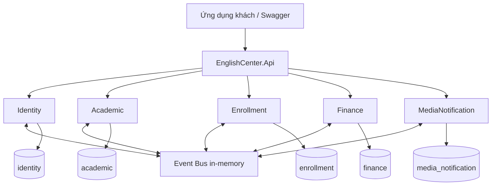

<div align="center">

# English Center

### Hệ thống quản lý trung tâm Tiếng Anh

Backend .NET theo kiến trúc Modular Monolith, tổ chức nghiệp vụ thành các module độc lập.


[Bắt đầu](#bắt-đầu) · [Kiến trúc](#kiến-trúc) · [API](#api) · [Kiểm thử](#kiểm-thử) · [Đóng góp](#đóng-góp)

</div>

---

## Tổng quan

English Center hướng tới quản lý toàn bộ luồng vận hành đào tạo: tài khoản, lớp học, lịch học, ghi danh, điểm danh, bài tập, học phí và thông báo. Hệ thống phục vụ ba nhóm người dùng chính: học viên, giáo viên và giáo vụ/quản trị.

Dự án sử dụng **một ứng dụng triển khai, nhiều module nghiệp vụ**. Mỗi module có ranh giới dữ liệu và các tầng riêng, giúp các thành viên phát triển song song mà vẫn giữ khả năng kiểm thử và tích hợp.

> Dự án đang phát triển. Nhánh TV3 đã tích hợp `develop` tại `fc3542d`, gồm phần TV1 tuần 3 trong [PR #8](https://github.com/nguyenvudung365-commits/english-center/pull/8). Phần ghi danh và hóa đơn tuần 3 được mô tả tại [TV3_WEEK3.md](TV3_WEEK3.md). Việc có cấu hình CI/CD không đồng nghĩa hệ thống đã được triển khai production.

## Trạng thái

| Phạm vi | Hiện trạng |
|---|---|
| Nền tảng | Solution 5 module, Event Bus in-memory, DbContext/schema riêng, Swagger, health endpoint |
| Identity | Đã tích hợp vào develop: đăng nhập, JWT, refresh token, đăng xuất, đổi mật khẩu, tạo tài khoản và phân quyền |
| TV1 tuần 3 — PR #8 | Bổ sung `ICurrentUser`, đọc claim an toàn, chuẩn phản hồi lỗi tại Host, API phát lại sự kiện tài khoản và kiểm thử phân quyền/hợp đồng lỗi |
| Academic | Đã tích hợp US-07: tạo/đọc lớp, danh mục khóa học mẫu, danh sách giáo viên đồng bộ từ `UserRegistered`, validation, phân quyền và event `ClassCreated` |
| Enrollment → Finance | US-12/US-23: lưu ghi danh và hóa đơn vào database, chặn trùng/đầy/kết thúc, transaction sĩ số, hóa đơn duy nhất theo EnrollmentId, đúng học phí/hạn; có replay đối soát và danh sách lớp của học viên |
| Kiểm thử | Bản TV3 tuần 3 tích hợp develop `fc3542d`, ngày 05/11/2026: **281 passed, 0 failed, 0 skipped**, gồm PostgreSQL thật của Identity và TV3 |
| Nghiệp vụ tiếp theo | Lịch học/lịch dạy, xác nhận thanh toán, bài tập, lưu file và thông báo tiếp tục được phát triển |
| Docker và CI/CD | `develop` đã có Dockerfile multi-stage, Compose, GitHub Actions, Jenkinsfile và script smoke container; xem phạm vi và giới hạn bên dưới |
| PostgreSQL | Identity/Academic/Enrollment/Finance có migration; CI đã cấu hình server kiểm thử riêng và bật cả test PostgreSQL của Identity lẫn TV3 |

Số liệu kiểm thử trên là kết quả local tại thời điểm bàn giao, không phải trạng thái CI trực tiếp. Repository hiện chưa có bản phát hành production.

## Kiến trúc



Các khối dữ liệu biểu diễn **schema riêng trong PostgreSQL**, không phải năm máy chủ database. Sơ đồ mô tả ranh giới kiến trúc; không khẳng định mọi luồng nghiệp vụ đã được triển khai.

| Module | Trách nhiệm | Schema |
|---|---|---|
| Identity | Tài khoản, xác thực, vai trò | `identity` |
| Academic | Lớp, lịch, điểm danh, bài tập, bài nộp và điểm | `academic` |
| Enrollment | Ghi danh, giới hạn vi phạm, cảnh báo, hẹn test | `enrollment` |
| Finance | Học phí và hóa đơn | `finance` |
| MediaNotification | Lưu file, thông báo, phản hồi và nội dung hỗ trợ | `media_notification` |

**Nguyên tắc thiết kế**

- Mỗi module có `Domain`, `Application`, `Infrastructure`, `Api` và `Contracts`.
- Controller gọi Application; nghiệp vụ không đặt trong controller.
- Module sở hữu DbContext, schema và migration của mình; không join hoặc truy vấn chéo schema.
- Giao tiếp liên module qua integration event hoặc contract công khai tối thiểu, không tham chiếu implementation của nhau.
- Architecture test kiểm tra ranh giới và tham chiếu project.
- Event Bus hiện chạy trong tiến trình, chưa có cơ chế giao nhận bền vững hay outbox.

## Cấu trúc

```text
.
├── src/
│   ├── BuildingBlocks/             # Domain primitives, Event Bus, role/claim
│   ├── Host/
│   │   └── EnglishCenter.Api/      # Điểm khởi động, Swagger, middleware
│   └── Modules/
│       ├── Identity/
│       ├── Academic/
│       ├── Enrollment/
│       ├── Finance/
│       └── MediaNotification/
├── tests/
│   ├── EnglishCenter.ArchitectureTests/
│   ├── EnglishCenter.Academic.Tests/
│   ├── EnglishCenter.BuildingBlocks.Tests/
│   └── EnglishCenter.IntegrationTests/
├── Directory.Build.props
├── Directory.Packages.props        # Quản lý phiên bản NuGet tập trung
├── Dockerfile
├── compose.yaml                    # API, PostgreSQL 17; storage R2 bên ngoài
├── compose.minio.yaml              # Stack MinIO riêng, chỉ local/test
├── Jenkinsfile
├── .github/workflows/ci.yml
├── scripts/ci-smoke.sh
├── EnglishCenter.sln
└── global.json                    # Quy định .NET SDK
```

## Bắt đầu

### Yêu cầu

- Git và **.NET SDK 10.0.400** hoặc phiên bản tương thích theo `global.json`.
- PostgreSQL để chạy nghiệp vụ Identity/Academic với dữ liệu thật.
- Docker Engine/Desktop và Docker Compose v2 nếu chạy bằng container.
- EF CLI 10.x nếu quản lý migration bằng dòng lệnh. Khởi tạo qua host không yêu cầu EF CLI.

### Chạy Swagger và kiểm tra nền tảng

```bash
git clone https://github.com/nguyenvudung365-commits/english-center.git
cd english-center
git switch develop
dotnet restore EnglishCenter.sln
dotnet build EnglishCenter.sln -c Release
dotnet run --project src/Host/EnglishCenter.Api
```

| Địa chỉ local | Mục đích |
|---|---|
| http://localhost:5080/swagger | Tài liệu API tương tác trong Development |
| http://localhost:5080/health | Kiểm tra host đang phục vụ yêu cầu |
| http://localhost:5080/api/identity/ping | Kiểm tra đăng ký module Identity |

Mặc định host không chạy migration lúc khởi động, nên Swagger và ping có thể hoạt động khi chưa cấu hình database. `/health` là kiểm tra hoạt động của host, **chưa kiểm tra kết nối PostgreSQL hay R2/S3**. Endpoint nghiệp vụ cần database đã khởi tạo.

### Khởi tạo Identity và admin

Tạo database `english_center` trong PostgreSQL, sau đó đặt biến môi trường trong PowerShell dùng để chạy API:

```powershell
$env:ConnectionStrings__Default = 'Host=localhost;Port=5432;Database=english_center;Username=<db-user>;Password=<db-password>'
$env:Jwt__SigningKey = [Convert]::ToBase64String([System.Security.Cryptography.RandomNumberGenerator]::GetBytes(48))
$env:Identity__InitializeDatabase = 'true'
$env:Academic__InitializeDatabase = 'true'
$env:Identity__BootstrapAdmin__Email = 'admin@example.test'
$env:Identity__BootstrapAdmin__FullName = 'Administrator'
$env:Identity__BootstrapAdmin__Password = (Get-Credential -UserName $env:Identity__BootstrapAdmin__Email -Message 'Nhap mat khau admin it nhat 8 ky tu').GetNetworkCredential().Password
dotnet run --project src/Host/EnglishCenter.Api
```

Thay placeholder bằng cấu hình local. Hai biến InitializeDatabase cho phép chạy migration của Identity và Academic. Identity tạo admin nếu email chưa tồn tại; nếu đã là Admin thì giữ nguyên tài khoản/mật khẩu; nếu email thuộc role khác, bootstrap báo lỗi thay vì nâng quyền. Sau lần đầu có thể bỏ cả biến email và mật khẩu bootstrap.

<details>
<summary><strong>Các biến cấu hình</strong></summary>

| Biến | Giá trị mặc định / yêu cầu |
|---|---|
| `ConnectionStrings__Default` | Connection string PostgreSQL của môi trường chạy |
| `Jwt__SigningKey` | Ít nhất 32 byte UTF-8; bắt buộc ngoài Development |
| `Jwt__Issuer` | `EnglishCenter` |
| `Jwt__Audience` | `EnglishCenter` |
| `Jwt__AccessTokenMinutes` | `15`, cho phép 1–60 phút |
| `Jwt__RefreshTokenDays` | `7`, cho phép 1–30 ngày |
| `Identity__InitializeDatabase` | `false`; bật để chạy migration khi khởi động |
| `Academic__InitializeDatabase` | `false`; bật để chạy migration Academic và seed danh mục khóa học mẫu |
| `Identity__BootstrapAdmin__Email` | Tùy chọn, email admin đầu tiên |
| `Identity__BootstrapAdmin__FullName` | `Administrator` |
| `Identity__BootstrapAdmin__Password` | 8–128 ký tự khi cấu hình bootstrap |

Development tự sinh signing key trong bộ nhớ nếu chưa có cấu hình. Token cũ không còn hợp lệ sau khi restart với key mới. Môi trường triển khai phải cấp key ổn định bằng secret/environment; không đưa key hoặc mật khẩu thật vào Git. .NET không tự nạp file `.env`.

</details>

### Chạy bằng Docker Compose

**Mặc định dùng Cloudflare R2**, không chạy MinIO. Tại thư mục gốc, nếu chưa có `.env`, sao chép mẫu rồi điền cấu hình thật (không ghi đè file đang dùng):

```powershell
Copy-Item .env.example .env
```

Trong `.env`, cấu hình `POSTGRES_PASSWORD`, `JWT_SIGNING_KEY` (ít nhất 32 byte UTF-8), `MEDIA_STORAGE_ENDPOINT`, `MEDIA_STORAGE_PUBLIC_ENDPOINT`, `MEDIA_STORAGE_BUCKET` và cặp R2 **Access Key ID / Secret Access Key** qua `MEDIA_STORAGE_ACCESS_KEY`/`MEDIA_STORAGE_SECRET_KEY`. Hai endpoint dùng cùng S3 API HTTPS từ Cloudflare, ví dụ `https://<ACCOUNT_ID>.r2.cloudflarestorage.com`, **không thêm tên bucket**, không dùng domain website hoặc `r2.dev`. Region là `auto`. Token chỉ có Object Read & Write cho bucket cần dùng; không dùng Token value thay Secret Access Key. Bucket giữ private; CORS cấu hình trên Cloudflare, xem [hướng dẫn storage](docs/api/media-storage.md).

Nếu cần admin đầu tiên, đặt thêm `BOOTSTRAP_ADMIN_EMAIL` và `BOOTSTRAP_ADMIN_PASSWORD` (8–128 ký tự). Đây là mật khẩu website riêng, không phải mật khẩu email/VPS. Không commit `.env` hoặc secret thật. Cả hai stack Compose bật migration Identity, Academic, Enrollment, Finance và MediaNotification; không cần override Academic.

```bash
docker compose --env-file .env -f compose.yaml -f compose.web.yaml config --quiet
docker compose --env-file .env -f compose.yaml -f compose.web.yaml up -d --build --wait
docker compose --env-file .env -f compose.yaml -f compose.web.yaml ps
```

- API health: `http://localhost:5080/health`; Compose chạy **Production nên không bật Swagger**.
- Web: `http://127.0.0.1:8088`, proxy `/api/` nội bộ. VPS dùng Caddy/HTTPS đến cổng này; Cloudflare Full (strict). Có thể bỏ overlay `compose.web.yaml` khi chỉ cần backend.
- PostgreSQL chỉ dùng mạng nội bộ Compose; API/web bind `127.0.0.1`. R2 là dịch vụ bên ngoài, không có container/cổng MinIO. Health không thay thế kiểm chứng upload-confirm-download.
- Database nằm trong volume `postgres-data`, file nằm ở bucket R2. Giữ nguyên project name khi cập nhật. Với VPS đã dùng `compose.vps.yaml`, project `english-center` và volume `english-center_postgres-data`, **không đổi lệnh triển khai hoặc tên project tùy tiện**. Bản sửa repo không tự cập nhật VPS, không chuyển file MinIO cũ sang R2.
- Dừng bằng `docker compose --env-file .env -f compose.yaml -f compose.web.yaml down`; không thêm `--volumes` nếu cần giữ dữ liệu. Giữ nguyên mật khẩu database/JWT qua các lần deploy, sao lưu database trước khi thay cấu hình đang chạy.

#### MinIO chỉ dành cho local/test

Nếu chưa có R2, sao chép `.env.minio.example` thành `.env.minio` (chỉ khi file chưa tồn tại), điền secret mới dành riêng cho local, rồi chạy **file độc lập thay cho `compose.yaml`**, với project khác để không đụng database triển khai:

```bash
docker compose --env-file .env.minio --project-name english-center-local -f compose.minio.yaml -f compose.web.yaml up -d --build
```

MinIO API/console chỉ bind loopback `9000`/`9001`. API chờ `minio-init` tạo bucket private và user app theo prefix, không dùng root credentials. Nếu đổi `MINIO_PORT`, đổi `MEDIA_STORAGE_PUBLIC_ENDPOINT` tương ứng. Không dùng `compose.minio.yaml` làm overlay của bản R2; không dùng credentials hay database VPS cho test. Khi chạy song song phải đổi API/web/MinIO ports để tránh trùng.

### CI/CD và giới hạn kiểm chứng

| Thành phần | Phạm vi cấu hình hiện có |
|---|---|
| GitHub Actions | PR vào `main`/`develop`, push vào hai nhánh và chạy thủ công; restore, build Release, test, lưu TRX, sau đó container smoke |
| `scripts/ci-smoke.sh` | Stack tạm qua `compose.minio.yaml`, không nạp `.env` triển khai; kiểm tra health, bootstrap admin, login, tạo Student, logout và refresh token bị thu hồi; dọn riêng stack/volume tạm khi kết thúc |
| Jenkins | Agent Linux nhãn `dotnet10-docker`; build/test/smoke; build image; chỉ deploy R2 trên `main` khi bật `DEPLOY`, dùng credential file `english-center-deploy-env` theo `.env.example`; chạy trên Docker host của agent, không tự SSH tới VPS |

Smoke script cần Bash, Docker Compose, `curl`, `jq` và `openssl`. Kiểm tra cấu hình R2/MinIO cần thêm Python 3 nhưng không cần Docker daemon: `bash tests/scripts/compose-storage-tests.sh`; kiểm tra smoke runner bằng mock: `bash tests/scripts/ci-smoke-tests.sh`. Smoke hiện **chưa kiểm tra luồng Teacher → Academic → tạo/đọc lớp hay upload R2 thật**. Có Jenkinsfile không chứng minh Jenkins/VPS/Cloudflare đã được kết nối: **push GitHub chưa tự cập nhật VPS** nếu chưa cấu hình job/agent triển khai. Xem kết quả CI thực tế tại [GitHub Actions](https://github.com/nguyenvudung365-commits/english-center/actions).

Tại commit `1cddae3`, [CI của PR #8](https://github.com/nguyenvudung365-commits/english-center/actions/runs/41798374475) đã hoàn tất thành công cả `build-and-test` và `container-smoke`. Kết quả smoke chỉ xác nhận phạm vi script mô tả ở trên; commit README mới sẽ kích hoạt lượt CI riêng.

## API

| Method | Endpoint | Quyền |
|---|---|---|
| `POST` | `/api/identity/auth/login` | Không yêu cầu Bearer |
| `POST` | `/api/identity/auth/refresh` | Refresh token hợp lệ |
| `POST` | `/api/identity/auth/logout` | Bearer + refresh token thuộc người dùng |
| `POST` | `/api/identity/auth/change-password` | Bearer |
| `POST` | `/api/identity/users` | `Staff` hoặc `Admin` |
| `POST` | `/api/identity/users/republish` | `Admin` |
| `POST` | `/api/academic/classes` | `Staff` hoặc `Admin` |
| `GET` | `/api/academic/classes/{id}` | `Staff` hoặc `Admin` |
| `GET` | `/api/academic/courses` | `Staff` hoặc `Admin` |
| `GET` | `/api/academic/teachers` | `Staff` hoặc `Admin` |

**Luồng sử dụng:** đăng nhập admin → lấy `accessToken` → nhập token vào **Authorize** trong Swagger → tạo tài khoản học viên/giáo viên.

```json
{
  "email": "student@example.test",
  "fullName": "Học viên",
  "password": "<mat-khau-it-nhat-8-ky-tu>",
  "role": "Student"
}
```

Endpoint tạo tài khoản chỉ nhận `Student` hoặc `Teacher`, không cấp Staff/Admin. Các role dùng chung là `Student`, `Teacher`, `Staff`, `Admin`; JWT có `sub` chứa GUID người dùng và `role` giữ nguyên tên claim.

Mật khẩu dùng PasswordHasher của ASP.NET Core Identity. Refresh token chỉ lưu dạng hash, thay mới sau mỗi lần refresh; đăng xuất thu hồi phiên gửi lên, đổi mật khẩu thu hồi toàn bộ refresh token. **Access token đã phát vẫn có hiệu lực đến khi hết hạn.** Auth endpoint giới hạn 20 yêu cầu/phút/IP; khi triển khai sau proxy cần cấu hình IP client đúng.

`POST /api/identity/users/republish` (chỉ `Admin`, body `{ "role": "Teacher" }` hoặc `{}`) phát lại `UserRegistered` cho tài khoản đã có để module khác đồng bộ; handler nhận phải idempotent theo `UserId`.

**TV1 tuần 3:** `ICurrentUser` trong BuildingBlocks cung cấp `IsAuthenticated`, `UserId`, `Role`, `IsInRole`; Host triển khai bằng HTTP context. Claim `sub` không phải GUID trả `UserId = null`, không tự tạo ID mặc định. Interface này hỗ trợ đọc danh tính, không thay thế kiểm tra role và quyền sở hữu dữ liệu trong từng module.

**Dạng lỗi API:** Host đăng ký Problem Details, exception handler và status-code pages. Dữ liệu validation sai có `errors` theo trường; các trường hợp 401/403/404/429/500 được kiểm thử theo hợp đồng lỗi, phản hồi 500 không lộ stack trace. Đây không phải cơ chế giao dịch hoặc retry liên module. Chi tiết token, claim, ma trận quyền và quy ước dữ liệu thuộc chủ sở hữu: [hợp đồng xác thực và lỗi](docs/api/hop-dong-xac-thuc-va-loi.md).

### Tạo lớp Academic

Sau khi khởi tạo cả hai schema, đăng nhập Staff/Admin và thực hiện:

1. Tạo tài khoản `Teacher` qua `/api/identity/users`. Event `UserRegistered` dựng bản sao giáo viên trong Academic. Với tài khoản đã tồn tại, Admin gọi `POST /api/identity/users/republish` với `{ "role": "Teacher" }`; body `{}` phát lại cho mọi role, kể cả admin bootstrap. Module nhận tự lọc role. Số `published` là số tài khoản đã được phát sự kiện, không bảo đảm mọi handler đã lưu thành công; bus chưa có outbox/retry bền vững.
2. Lấy `courseId` từ `/api/academic/courses` và `teacherId` từ `/api/academic/teachers`.
3. Gọi `POST /api/academic/classes` với payload:

```json
{
  "code": "IELTS-2026-01",
  "name": "IELTS Foundation K1",
  "courseId": "<guid-khoa-hoc>",
  "classType": "Main",
  "startDate": "2026-11-02",
  "endDate": "2027-01-30",
  "maxStudents": 20,
  "tuitionFee": 4500000,
  "teacherId": "<guid-giao-vien>"
}
```

`classType` nhận `Main` hoặc `Supplementary`. Mã lớp được chuẩn hóa và phải duy nhất; ngày kết thúc sau ngày bắt đầu, sĩ số lớn hơn 0, học phí là số nguyên VND từ 0 đến 999.999.999.999. Tạo thành công trả 201 cùng địa chỉ đọc lại và phát `ClassCreated`. Trạng thái lớp suy ra từ ngày theo giờ Việt Nam (UTC+7).

**Đồng bộ lớp cũ sang Enrollment (TV3 tuần 3):** Staff/Admin gọi `POST /api/academic/classes/republish` (không body, 200 với `{ "published": N }`) để phát lại toàn bộ lớp, hoặc `POST /api/academic/classes/{id}/replay` (không body, 202; lớp không tồn tại trả 404) để phát lại một lớp. Chưa đăng nhập trả 401, Student/Teacher trả 403. Academic chỉ đọc schema của mình và phát `ClassCreated`; Enrollment dựng snapshot theo `ClassId`, không tạo trùng và không đặt lại sĩ số đang có. Phản hồi chỉ xác nhận phát sự kiện, cần kiểm tra luồng ghi danh/hóa đơn và log handler để xác nhận đồng bộ. Xem [hướng dẫn backfill và demo tuần 3](TV3_WEEK3.md#backfill-lớp-và-tài-khoản-đã-tồn-tại) để có lệnh PowerShell cụ thể.

### Ghi danh và quyền truy cập bài tập

`/api/enrollment/enrollments` là luồng ghi danh có kiểm tra sĩ số, học phí, giới hạn vi phạm và phát sự kiện tạo hóa đơn. `/api/enrollment/memberships` chỉ cấp/thu hồi quyền bài tập trên ghi danh còn hiệu lực đã có; không tự tạo ghi danh, hóa đơn hoặc thay đổi sĩ số. Thu hồi quyền bài tập không hủy ghi danh hay hóa đơn.

Migration `UnifyEnrollmentMembership` hợp nhất quyền bài tập cũ vào bản ghi ghi danh. Sao lưu database trước khi cập nhật. Nếu có dữ liệu `class_enrollments` chưa có ghi danh tương ứng, migration chủ động dừng và giữ dữ liệu: cần giáo vụ đối soát, tạo ghi danh bằng luồng nghiệp vụ với học phí/giới hạn đã duyệt, kiểm tra sĩ số và phát lại sự kiện còn thiếu trước khi chạy lại. Không tự biến quyền bài tập cũ thành nghĩa vụ học phí. Migration này không hỗ trợ rollback tự động; khôi phục bản sao lưu nếu cần trở về trước khi hợp nhất.

## Kiểm thử

```bash
dotnet test EnglishCenter.sln -c Release
```

| Bộ kiểm thử | Phạm vi |
|---|---|
| ArchitectureTests | Ranh giới module, dependency và ProjectReference |
| BuildingBlocks.Tests | Event Bus, DI scope và hành vi xử lý handler |
| Academic.Tests | Domain/Application tạo lớp, validation và handler đồng bộ giáo viên |
| IntegrationTests | Host, ping, schema, Identity/Academic qua HTTP; Media validation/quyền sở hữu/immutable file; chống ghi nhận trùng EnrollmentId trong recorder Finance |

Auth test dùng SQLite trong bộ nhớ và không yêu cầu PostgreSQL ngoài. Kiểm tra SQL migration không thay thế việc chạy migration, constraint và luồng nghiệp vụ trên PostgreSQL thật.

Kiểm chứng PostgreSQL: đặt biến môi trường `ENGLISHCENTER_TEST_POSTGRES` là chuỗi kết nối tới server PostgreSQL có quyền tạo database; test tự tạo database tạm và xóa khi xong. Chạy bằng:

```bash
dotnet test tests/EnglishCenter.IntegrationTests --filter "FullyQualifiedName~IdentityPostgresTests|FullyQualifiedName~MediaFilePostgresTests"
```

Để chạy tự động trên PostgreSQL 17 cô lập (Bash, Docker daemon đang chạy, .NET 10 và OpenSSL):

```bash
bash tests/scripts/ci-postgres-tests.sh  # Kiểm tra runner bằng mock, không chạy database thật
bash scripts/ci-postgres.sh             # Chạy 4 Identity + 2 Media trên PostgreSQL thật
```

Runner sinh mật khẩu riêng, mở cổng PostgreSQL ngẫu nhiên chỉ trên loopback, chờ database sẵn sàng rồi chạy bộ test Identity và Media (migration riêng, CAS revision đồng thời, chặn owner khác). Runner yêu cầu TRX có ít nhất 6 test đã chạy, tất cả đạt và không bỏ qua; lỗi test, thiếu báo cáo hoặc database không sẵn sàng đều làm bước CI thất bại. Container và volume tạm được dọn sau khi chạy; không sử dụng database hay credential triển khai. Báo cáo thật được lưu dưới `TestResults/Postgres/<run-id>/`. Mock chạy trong thư mục tạm riêng, không tạo bằng chứng PostgreSQL giả trong `TestResults`.

Jenkins có bước **Identity và Media trên PostgreSQL thật** riêng bên cạnh test thường và smoke Compose. Compose hiện bật migration Identity, Academic và MediaNotification khi API khởi động. Việc thêm bước CI không có nghĩa bước đó đã chạy đạt: nếu Docker daemon chưa chạy, runner sẽ báo lỗi ngay. API cấp presigned URL của MediaNotification được mô tả trong phần TV4 bên dưới.

Kết quả local sau khi tích hợp `develop`, tại commit `1cddae3`, bằng `dotnet test EnglishCenter.sln --nologo`:

| Project test | Passed | Skipped | Failed |
|---|---:|---:|---:|
| BuildingBlocks.Tests | 32 | 0 | 0 |
| Academic.Tests | 54 | 0 | 0 |
| ArchitectureTests | 53 | 0 | 0 |
| IntegrationTests | 116 | 4 | 0 |
| **Tổng** | **255** | **4** | **0** |

Bốn test `IdentityPostgresTests` (F1–F4) bị bỏ qua vì chưa cấu hình biến môi trường trong lần chạy này. Kết quả trên là **local, cấu hình Debug mặc định**, không phải bằng chứng CI Release/container smoke hoặc triển khai production đã đạt. Không đặt `ENGLISHCENTER_TEST_POSTGRES` trỏ vào database nghiệp vụ; dùng server kiểm thử riêng vì test tạo/xóa database tạm.

## Đóng góp

```text
main                         Bản ổn định
└── develop                  Nhánh tích hợp
    └── feature/<cong-viec>   Nhánh tính năng, mở PR vào develop
```

1. Tạo nhánh từ `develop` đã cập nhật; thống nhất contract trước khi thay đổi giao tiếp liên module.
2. Triển khai trong phạm vi được giao, bổ sung kiểm thử phù hợp và chạy toàn bộ test.
3. Mở Pull Request vào `develop`, mô tả thay đổi, cách kiểm tra và giới hạn còn lại bằng tiếng Việt.
4. Nhờ thành viên khác review trước khi merge. Cuối sprint tích hợp từ `develop` vào `main`.

Identity, US-07, test TV3 tuần 1–2 và cấu hình CI/CD đã có trên `develop`; phần TV1 tuần 3 được bàn giao qua PR #8. Tạo nhánh từ `develop` đã cập nhật để dùng đúng contract sau khi PR được merge. Ghi riêng kết quả local, CI và kiểm chứng PostgreSQL/container trong PR. Test TV3 xác minh recorder hiện có, không đánh dấu US-12/US-23 (ghi danh/hóa đơn thực tế) đã hoàn thành.

## Nhóm phát triển

| Thành viên | Phụ trách |
|---|---|
| Nguyễn Vũ Dũng | Identity, BuildingBlocks và tích hợp xác thực |
| Lê Đỗ Việt Tùng | Academic |
| Nguyễn Hồng Lịch | Enrollment, Finance và phối hợp kiểm thử tích hợp |
| Nguyễn Lý Tiền | MediaNotification, lưu trữ và hạ tầng CI/CD |

**Nhóm 10 · Môn 608819 · Phát triển ứng dụng phía máy chủ nâng cao**

Mã nguồn được quản lý tại repository này. Tài liệu báo cáo và phân công chi tiết lưu riêng trên Google Drive của nhóm.

## Bổ sung TV4 tuần 3 — lưu file MediaNotification

Lát cắt hiện tại bổ sung ba API Bearer owner-only: `POST /api/media-notification/files/presign`, `POST /api/media-notification/files/{fileId}/confirm`, `GET /api/media-notification/files/{fileId}/download`. Không bao gồm thông báo tuần 4 hay nghiệp vụ nộp bài Academic.

Compose gốc bật migration Identity, Academic **và MediaNotification**, mặc định kết nối R2 theo `.env.example`; bucket private và CORS phải cấu hình trên Cloudflare. MinIO chỉ còn trong `compose.minio.yaml` cho local/test: init client build từ commit upstream được pin, tạo bucket private và policy theo prefix; API không dùng root MinIO. Không tự nhận upload R2 đã chạy đạt chỉ vì Compose config hợp lệ hoặc container healthy.

Xem [hợp đồng lưu file, cấu hình bucket và luồng upload thật](docs/api/media-storage.md) để có ma trận extension/MIME, giới hạn 20 MiB, expiry 5 phút, ProblemDetails, concurrency/anti-replay và lệnh kiểm chứng PowerShell. Kiểm tra định dạng **không phải quét malware**; URL đã ký là bearer capability có thể bị chia sẻ. Các số liệu test cũ ở trên vẫn là lịch sử, không phải kết quả kiểm chứng của phần bổ sung này.

**Chưa đủ điều kiện mở public:** giới hạn 20 MiB được kiểm tra khi xác nhận, không phải hạn mức ingress cho PUT staging. Trước khi public cần giới hạn upload ở tầng storage/proxy, quota và số ticket theo người dùng, giới hạn số confirm đồng thời, cùng lifecycle chỉ cho `staging/`. Chưa có background garbage collector; không đặt expiry cho toàn bộ `files/` đang được metadata tham chiếu.
