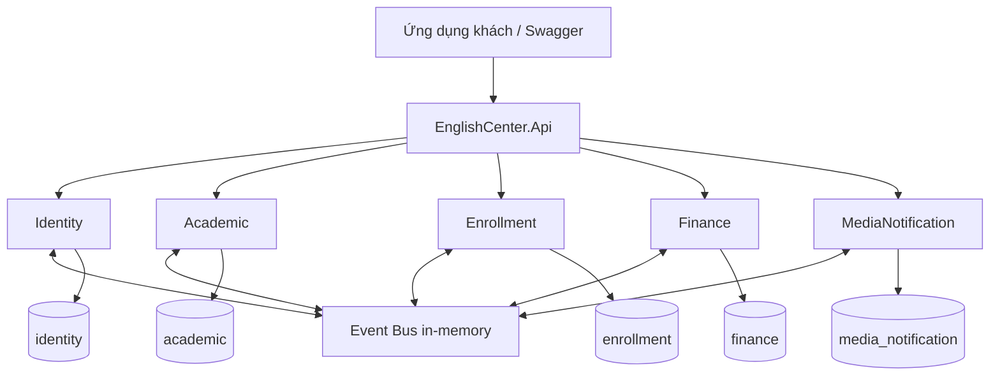

<div align="center">

# English Center

### Hệ thống quản lý trung tâm Tiếng Anh

Backend .NET theo kiến trúc Modular Monolith, tổ chức nghiệp vụ thành các module độc lập.


[Bắt đầu](#bắt-đầu) · [Kiến trúc](#kiến-trúc) · [API](#api) · [Kiểm thử](#kiểm-thử) · [Đóng góp](#đóng-góp)

</div>

---

## Tổng quan

English Center hướng tới quản lý toàn bộ luồng vận hành đào tạo: tài khoản, lớp học, lịch học, ghi danh, điểm danh, bài tập, học phí và thông báo. Hệ thống phục vụ ba nhóm người dùng chính: học viên, giáo viên và giáo vụ/quản trị.

Dự án sử dụng **một ứng dụng triển khai, nhiều module nghiệp vụ**. Mỗi module có ranh giới dữ liệu và các tầng riêng, giúp các thành viên phát triển song song mà vẫn giữ khả năng kiểm thử và tích hợp.

> Dự án đang phát triển. Nhánh `develop` đã tích hợp Identity, tạo lớp Academic (US-07) và các kiểm thử luồng Enrollment → Finance. Nhánh `main` hiện giữ phần khung ban đầu; sử dụng `develop` để chạy các chức năng mô tả bên dưới.

## Trạng thái

| Phạm vi | Hiện trạng |
|---|---|
| Nền tảng | Solution 5 module, Event Bus in-memory, DbContext/schema riêng, Swagger, health endpoint |
| Identity | Đã tích hợp vào develop: đăng nhập, JWT, refresh token, đăng xuất, đổi mật khẩu, tạo tài khoản và phân quyền |
| Academic | Đã tích hợp US-07: tạo/đọc lớp, danh mục khóa học mẫu, danh sách giáo viên đồng bộ từ `UserRegistered`, validation, phân quyền và event `ClassCreated` |
| Enrollment → Finance | Đã bổ sung test chuyển dữ liệu sang handler Finance, chống ghi nhận trùng EnrollmentId và publish đồng thời; recorder hiện vẫn là in-memory, chưa phải hóa đơn lưu database |
| Kiểm thử | Review riêng nhánh US-07: **173 test đạt**; nhánh test TV3: **83 test đạt**. Đây là hai nền code khác nhau, không cộng thành tổng test của develop |
| Nghiệp vụ tiếp theo | Lịch học, ghi danh thực tế, hóa đơn bền vững, bài tập, lưu file và thông báo tiếp tục được phát triển |
| Docker và CI/CD | Gói bàn giao cho TV4 đang chờ kiểm chứng và tích hợp vào repository |
| PostgreSQL thực tế | Đã có migration Identity và kiểm tra script; chưa xác nhận chạy toàn bộ luồng auth trên PostgreSQL thật |

Số liệu kiểm thử trên là kết quả local tại thời điểm bàn giao, không phải trạng thái CI trực tiếp. Repository hiện chưa có bản phát hành production.

## Kiến trúc



Các khối dữ liệu biểu diễn **schema riêng trong PostgreSQL**, không phải năm máy chủ database. Sơ đồ mô tả ranh giới kiến trúc; không khẳng định mọi luồng nghiệp vụ đã được triển khai.

| Module | Trách nhiệm | Schema |
|---|---|---|
| Identity | Tài khoản, xác thực, vai trò | `identity` |
| Academic | Lớp, lịch, điểm danh, bài tập, bài nộp và điểm | `academic` |
| Enrollment | Ghi danh, giới hạn vi phạm, cảnh báo, hẹn test | `enrollment` |
| Finance | Học phí và hóa đơn | `finance` |
| MediaNotification | Lưu file, thông báo, phản hồi và nội dung hỗ trợ | `media_notification` |

**Nguyên tắc thiết kế**

- Mỗi module có `Domain`, `Application`, `Infrastructure`, `Api` và `Contracts`.
- Controller gọi Application; nghiệp vụ không đặt trong controller.
- Module sở hữu DbContext, schema và migration của mình; không join hoặc truy vấn chéo schema.
- Giao tiếp liên module qua integration event hoặc contract công khai tối thiểu, không tham chiếu implementation của nhau.
- Architecture test kiểm tra ranh giới và tham chiếu project.
- Event Bus hiện chạy trong tiến trình, chưa có cơ chế giao nhận bền vững hay outbox.

## Cấu trúc

```text
.
├── src/
│   ├── BuildingBlocks/             # Domain primitives, Event Bus, role/claim
│   ├── Host/
│   │   └── EnglishCenter.Api/      # Điểm khởi động, Swagger, middleware
│   └── Modules/
│       ├── Identity/
│       ├── Academic/
│       ├── Enrollment/
│       ├── Finance/
│       └── MediaNotification/
├── tests/
│   ├── EnglishCenter.ArchitectureTests/
│   ├── EnglishCenter.BuildingBlocks.Tests/
│   └── EnglishCenter.IntegrationTests/
├── Directory.Build.props
├── Directory.Packages.props        # Quản lý phiên bản NuGet tập trung
├── EnglishCenter.sln
└── global.json                    # Quy định .NET SDK
```

## Bắt đầu

### Yêu cầu

- Git và **.NET SDK 10.0.400** hoặc phiên bản tương thích theo `global.json`.
- PostgreSQL để chạy nghiệp vụ Identity với dữ liệu thật.
- EF CLI 10.x nếu quản lý migration bằng dòng lệnh. Khởi tạo qua host không yêu cầu EF CLI.

### Chạy Swagger và kiểm tra nền tảng

```bash
git clone https://github.com/nguyenvudung365-commits/english-center.git
cd english-center
git switch develop
dotnet restore EnglishCenter.sln
dotnet build EnglishCenter.sln -c Release
dotnet run --project src/Host/EnglishCenter.Api
```

| Địa chỉ local | Mục đích |
|---|---|
| http://localhost:5080/swagger | Tài liệu API tương tác trong Development |
| http://localhost:5080/health | Kiểm tra host đang phục vụ yêu cầu |
| http://localhost:5080/api/identity/ping | Kiểm tra đăng ký module Identity |

Mặc định host không chạy migration lúc khởi động, nên Swagger và ping có thể hoạt động khi chưa cấu hình database. `/health` là kiểm tra hoạt động của host, **chưa kiểm tra kết nối PostgreSQL hay MinIO**. Endpoint nghiệp vụ cần database đã khởi tạo.

### Khởi tạo Identity và admin

Tạo database `english_center` trong PostgreSQL, sau đó đặt biến môi trường trong PowerShell dùng để chạy API:

```powershell
$env:ConnectionStrings__Default = 'Host=localhost;Port=5432;Database=english_center;Username=<db-user>;Password=<db-password>'
$env:Jwt__SigningKey = [Convert]::ToBase64String([System.Security.Cryptography.RandomNumberGenerator]::GetBytes(48))
$env:Identity__InitializeDatabase = 'true'
$env:Academic__InitializeDatabase = 'true'
$env:Identity__BootstrapAdmin__Email = 'admin@example.test'
$env:Identity__BootstrapAdmin__FullName = 'Administrator'
$env:Identity__BootstrapAdmin__Password = (Get-Credential -UserName $env:Identity__BootstrapAdmin__Email -Message 'Nhap mat khau admin it nhat 8 ky tu').GetNetworkCredential().Password
dotnet run --project src/Host/EnglishCenter.Api
```

Thay placeholder bằng cấu hình local. Hai biến InitializeDatabase cho phép chạy migration của Identity và Academic. Identity tạo admin nếu email chưa tồn tại; nếu đã là Admin thì giữ nguyên tài khoản/mật khẩu; nếu email thuộc role khác, bootstrap báo lỗi thay vì nâng quyền. Sau lần đầu có thể bỏ cả biến email và mật khẩu bootstrap.

<details>
<summary><strong>Các biến cấu hình</strong></summary>

| Biến | Giá trị mặc định / yêu cầu |
|---|---|
| `ConnectionStrings__Default` | Connection string PostgreSQL của môi trường chạy |
| `Jwt__SigningKey` | Ít nhất 32 byte UTF-8; bắt buộc ngoài Development |
| `Jwt__Issuer` | `EnglishCenter` |
| `Jwt__Audience` | `EnglishCenter` |
| `Jwt__AccessTokenMinutes` | `15`, cho phép 1–60 phút |
| `Jwt__RefreshTokenDays` | `7`, cho phép 1–30 ngày |
| `Identity__InitializeDatabase` | `false`; bật để chạy migration khi khởi động |
| `Academic__InitializeDatabase` | `false`; bật để chạy migration Academic và seed danh mục khóa học mẫu |
| `Identity__BootstrapAdmin__Email` | Tùy chọn, email admin đầu tiên |
| `Identity__BootstrapAdmin__FullName` | `Administrator` |
| `Identity__BootstrapAdmin__Password` | 8–128 ký tự khi cấu hình bootstrap |

Development tự sinh signing key trong bộ nhớ nếu chưa có cấu hình. Token cũ không còn hợp lệ sau khi restart với key mới. Môi trường triển khai phải cấp key ổn định bằng secret/environment; không đưa key hoặc mật khẩu thật vào Git. .NET không tự nạp file `.env`.

</details>

## API

| Method | Endpoint | Quyền |
|---|---|---|
| `POST` | `/api/identity/auth/login` | Không yêu cầu Bearer |
| `POST` | `/api/identity/auth/refresh` | Refresh token hợp lệ |
| `POST` | `/api/identity/auth/logout` | Bearer + refresh token thuộc người dùng |
| `POST` | `/api/identity/auth/change-password` | Bearer |
| `POST` | `/api/identity/users` | `Staff` hoặc `Admin` |
| `POST` | `/api/academic/classes` | `Staff` hoặc `Admin` |
| `GET` | `/api/academic/classes/{id}` | `Staff` hoặc `Admin` |
| `GET` | `/api/academic/courses` | `Staff` hoặc `Admin` |
| `GET` | `/api/academic/teachers` | `Staff` hoặc `Admin` |

**Luồng sử dụng:** đăng nhập admin → lấy `accessToken` → nhập token vào **Authorize** trong Swagger → tạo tài khoản học viên/giáo viên.

```json
{
  "email": "student@example.test",
  "fullName": "Học viên",
  "password": "<mat-khau-it-nhat-8-ky-tu>",
  "role": "Student"
}
```

Endpoint tạo tài khoản chỉ nhận `Student` hoặc `Teacher`, không cấp Staff/Admin. Các role dùng chung là `Student`, `Teacher`, `Staff`, `Admin`; JWT có `sub` chứa GUID người dùng và `role` giữ nguyên tên claim.

Mật khẩu dùng PasswordHasher của ASP.NET Core Identity. Refresh token chỉ lưu dạng hash, thay mới sau mỗi lần refresh; đăng xuất thu hồi phiên gửi lên, đổi mật khẩu thu hồi toàn bộ refresh token. **Access token đã phát vẫn có hiệu lực đến khi hết hạn.** Auth endpoint giới hạn 20 yêu cầu/phút/IP; khi triển khai sau proxy cần cấu hình IP client đúng.

### Tạo lớp Academic

Sau khi khởi tạo cả hai schema, đăng nhập Staff/Admin và thực hiện:

1. Tạo tài khoản `Teacher` qua `/api/identity/users`. Event `UserRegistered` dựng bản sao giáo viên trong Academic; tài khoản tạo từ trước cần được đồng bộ riêng.
2. Lấy `courseId` từ `/api/academic/courses` và `teacherId` từ `/api/academic/teachers`.
3. Gọi `POST /api/academic/classes` với payload:

```json
{
  "code": "IELTS-2026-01",
  "name": "IELTS Foundation K1",
  "courseId": "<guid-khoa-hoc>",
  "classType": "Main",
  "startDate": "2026-11-02",
  "endDate": "2027-01-30",
  "maxStudents": 20,
  "tuitionFee": 4500000,
  "teacherId": "<guid-giao-vien>"
}
```

`classType` nhận `Main` hoặc `Supplementary`. Mã lớp được chuẩn hóa và phải duy nhất; ngày kết thúc sau ngày bắt đầu, sĩ số lớn hơn 0, học phí là số nguyên VND từ 0 đến 999.999.999.999. Tạo thành công trả 201 cùng địa chỉ đọc lại và phát `ClassCreated`. Trạng thái lớp suy ra từ ngày theo giờ Việt Nam (UTC+7).

## Kiểm thử

```bash
dotnet test EnglishCenter.sln -c Release
```

| Bộ kiểm thử | Phạm vi |
|---|---|
| ArchitectureTests | Ranh giới module, dependency và ProjectReference |
| BuildingBlocks.Tests | Event Bus, DI scope và hành vi xử lý handler |
| Academic.Tests | Domain/Application tạo lớp, validation và handler đồng bộ giáo viên |
| IntegrationTests | Host, ping, schema, Identity/Academic qua HTTP và chống ghi nhận trùng EnrollmentId trong recorder Finance |

Auth test dùng SQLite trong bộ nhớ và không yêu cầu PostgreSQL ngoài. Kiểm tra SQL migration không thay thế việc chạy migration, constraint và luồng nghiệp vụ trên PostgreSQL thật.

## Đóng góp

```text
main                         Bản ổn định
└── develop                  Nhánh tích hợp
    └── feature/<cong-viec>   Nhánh tính năng, mở PR vào develop
```

1. Tạo nhánh từ `develop` đã cập nhật; thống nhất contract trước khi thay đổi giao tiếp liên module.
2. Triển khai trong phạm vi được giao, bổ sung kiểm thử phù hợp và chạy toàn bộ test.
3. Mở Pull Request vào `develop`, mô tả thay đổi, cách kiểm tra và giới hạn còn lại bằng tiếng Việt.
4. Nhờ thành viên khác review trước khi merge. Cuối sprint tích hợp từ `develop` vào `main`.

Identity, US-07 và test TV3 hiện có trong develop. Tạo nhánh mới từ develop đã cập nhật để dùng đúng contract. CI/CD chưa tích hợp nên kết quả local cần được ghi rõ trong PR. Test TV3 xác minh recorder hiện có, không đánh dấu US-12/US-23 (ghi danh/hóa đơn thực tế) đã hoàn thành.

## Nhóm phát triển

| Thành viên | Phụ trách |
|---|---|
| Nguyễn Vũ Dũng | Identity, BuildingBlocks và tích hợp xác thực |
| Lê Đỗ Việt Tùng | Academic |
| Nguyễn Hồng Lịch | Enrollment, Finance và phối hợp kiểm thử tích hợp |
| Nguyễn Lý Tiền | MediaNotification, lưu trữ và hạ tầng CI/CD |

**Nhóm 10 · Môn 608819 · Phát triển ứng dụng phía máy chủ nâng cao**

Mã nguồn được quản lý tại repository này. Tài liệu báo cáo và phân công chi tiết lưu riêng trên Google Drive của nhóm.
