# Sơ đồ phân rã chức năng

Nhóm 10 - Môn 608819 - Phát triển ứng dụng phía máy chủ nâng cao (lớp 68CS1&2)
Phiên bản: v0.2 - bản hiệu chỉnh báo cáo. Ngày: 2026-10-22.
Nguồn dữ liệu: [Product Backlog](product-backlog.md) (mục 2, 5, 6), [tài liệu 01](01-yeu-cau-chuc-nang-phi-chuc-nang.md).

## 1. Giải thích ký hiệu

- Cấp 0: toàn hệ thống. Cấp 1: nhóm chức năng chính F1..F8. Cấp 2: chức năng con F-x.y (chức năng lá).
- Nhãn ưu tiên trong nút: M = Must, S = Should, C = Could.
- Màu nút cấp 1 theo module: xanh dương = Identity, xanh lá = Academic, cam = Enrollment, tím = Finance, vàng = MediaNotification, xám = nhiều module.
- Trạng thái triển khai: toàn bộ chức năng trong tài liệu này là Dự kiến (hiện mới có khung solution, chưa có nghiệp vụ).

Mỗi nút biểu diễn một hoạt động, không phải trường dữ liệu, trạng thái, ràng buộc hay công nghệ. Cạnh nối thể hiện quan hệ cha–con, không phải trình tự xử lý. Các ràng buộc (6 trạng thái điểm danh, thời hạn sửa 24 giờ, giới hạn nghỉ/trễ) được giữ ở bảng mô tả mục 4, không dùng làm nút chức năng.

## 2. Sơ đồ tổng (cấp 0-1)

Nguồn: backlog mục 5, 3.

```mermaid
flowchart TD
    ROOT["Hệ thống quản lý trung tâm Tiếng Anh"]
    F1["F1 Quản lý tài khoản và phân quyền (Identity)"]
    F2["F2 Quản lý lớp học và lịch học (Academic)"]
    F3["F3 Quản lý ghi danh (Enrollment)"]
    F4["F4 Quản lý điểm danh (Academic)"]
    F5["F5 Quản lý bài tập và điểm (Academic + MediaNotification)"]
    F6["F6 Quản lý học phí (Finance)"]
    F7["F7 Thông báo và lưu trữ file (MediaNotification)"]
    F8["F8 Tương tác và thống kê (nhiều module)"]
    ROOT --- F1
    ROOT --- F2
    ROOT --- F3
    ROOT --- F4
    ROOT --- F5
    ROOT --- F6
    ROOT --- F7
    ROOT --- F8
    classDef identity fill:#cfe2ff,stroke:#084298
    classDef academic fill:#d1e7dd,stroke:#0f5132
    classDef enrollment fill:#ffe5d0,stroke:#984c0c
    classDef finance fill:#e2d9f3,stroke:#432874
    classDef media fill:#fff3cd,stroke:#664d03
    classDef multi fill:#e9ecef,stroke:#495057
    classDef out fill:#f8f9fa,stroke:#adb5bd,stroke-dasharray: 4 4
    class F1 identity
    class F2,F4 academic
    class F3 enrollment
    class F6 finance
    class F7 media
    class F5,F8 multi
```

## 3. Sơ đồ con cấp 2 cho từng nhánh

### 3.1 F1 Quản lý tài khoản và phân quyền (Identity)

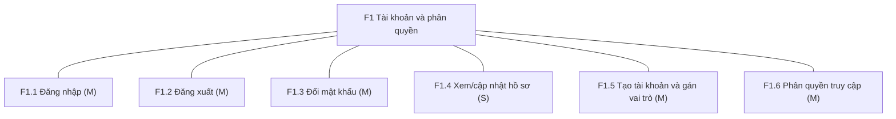

### 3.2 F2 Quản lý lớp học và lịch học (Academic)

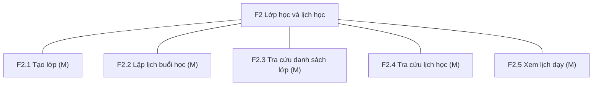

### 3.3 F3 Quản lý ghi danh (Enrollment)

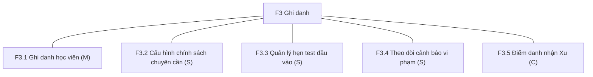

### 3.4 F4 Quản lý điểm danh (Academic)

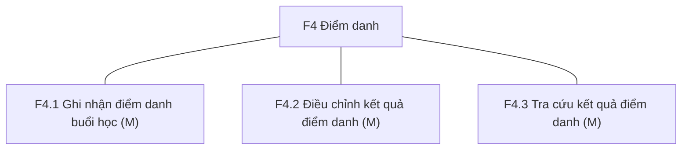

### 3.5 F5 Quản lý bài tập và điểm (Academic + MediaNotification)

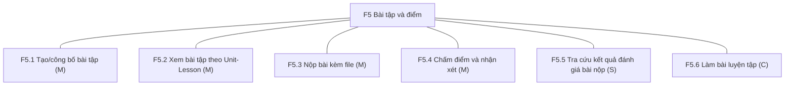

### 3.6 F6 Quản lý học phí (Finance)

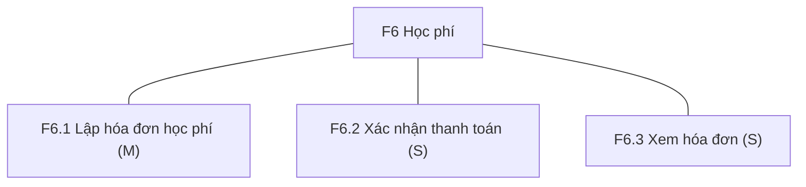

### 3.7 F7 Thông báo và lưu trữ file (MediaNotification)

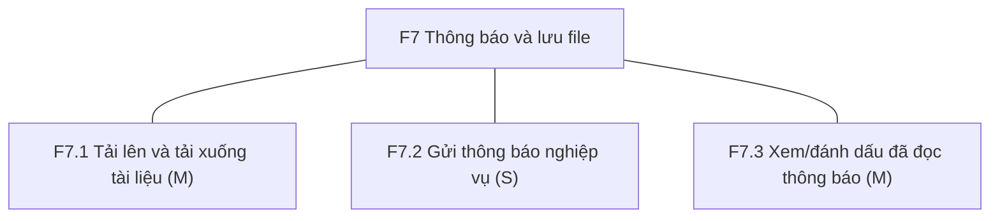

### 3.8 F8 Tương tác và thống kê

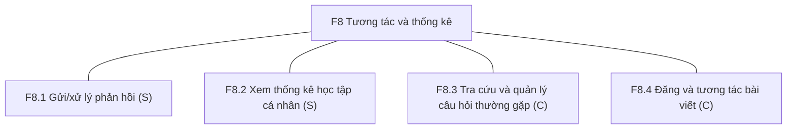

## 4. Bảng mô tả chức năng lá

| Mã | Tên | Mô tả | Tác nhân | Module | Ưu tiên | US |
|---|---|---|---|---|---|---|
| F1.1 | Đăng nhập | Email + mật khẩu, trả JWT; sai thông tin 401, khóa 403 | Mọi người dùng | Identity | Must | US-01 |
| F1.2 | Đăng xuất | Thu hồi refresh token | Mọi người dùng | Identity | Must | US-02 |
| F1.3 | Đổi mật khẩu | Đúng mật khẩu cũ, mới >= 8 ký tự, thu hồi token cũ | Mọi người dùng | Identity | Must | US-03 |
| F1.4 | Xem/cập nhật hồ sơ | Họ tên, email, SĐT, ảnh đại diện; mã học viên chỉ đọc | Học viên | Identity | Should | US-04 |
| F1.5 | Tạo tài khoản và gán vai trò | Email duy nhất; phát `UserRegistered` | Giáo vụ/Admin | Identity | Must | US-05 |
| F1.6 | Phân quyền truy cập | 401 khi thiếu token, 403 khi thiếu quyền | Hệ thống | Identity | Must | US-06 |
| F2.1 | Tạo lớp | Mã lớp duy nhất, ngày, sĩ số, loại lớp, giáo viên, học phí; phát `ClassCreated` | Giáo vụ | Academic | Must | US-07 |
| F2.2 | Lập lịch buổi học | Ngày, giờ, Unit-Lesson, kỹ năng, loại buổi, ca thi; chặn trùng giờ giáo viên | Giáo vụ | Academic | Must | US-08 |
| F2.3 | Xem danh sách lớp | Lọc theo trạng thái, số buổi đã học x/y, sĩ số | Học viên | Academic | Must | US-09 |
| F2.4 | Xem lịch học | Theo `from`/`to`, cờ `isCompleted` | Học viên | Academic | Must | US-10 |
| F2.5 | Xem lịch dạy | Chỉ lớp/buổi được phân công | Giáo viên | Academic | Must | US-11 |
| F3.1 | Ghi danh học viên | Chặn trùng/đầy/lớp kết thúc; phát `StudentEnrolled` | Giáo vụ | Enrollment | Must | US-12 |
| F3.2 | Cấu hình chính sách chuyên cần | Giới hạn nghỉ, trễ, bỏ bài; hiển thị đã dùng/giới hạn | Giáo vụ | Enrollment | Should | US-13 |
| F3.3 | Quản lý hẹn test đầu vào | Địa điểm, hình thức, thời gian, tên đề, trạng thái | Học viên, Giáo vụ | Enrollment | Should | US-14 |
| F3.4 | Theo dõi cảnh báo vi phạm | Tạo cảnh báo khi vượt giới hạn; phát `WarningIssued` | Hệ thống, Học viên | Enrollment | Should | US-15 |
| F3.5 | Điểm danh nhận Xu | Làm cuối cùng nếu còn thời gian | Học viên | Enrollment (tạm) | Could | US-33 |
| F4.1 | Điểm danh buổi học | 6 trạng thái; phát `AttendanceRecorded` | Giáo viên | Academic | Must | US-16 |
| F4.2 | Điều chỉnh kết quả điểm danh | Cho phép trong 24h sau buổi học | Giáo viên | Academic | Must | US-16 |
| F4.3 | Tra cứu kết quả điểm danh | Tỷ lệ % và số buổi theo trạng thái | Học viên | Academic | Must | US-17 |
| F5.1 | Tạo/công bố bài tập | Gắn buổi, loại, mở/đóng; phát `AssignmentPublished` | Giáo viên | Academic | Must | US-18 |
| F5.2 | Xem bài tập theo Unit-Lesson | Đã làm/Chưa làm/Đã bỏ | Học viên | Academic | Must | US-19 |
| F5.3 | Nộp bài kèm file | Presigned URL, `fileKey`, trong khoảng mở-đóng | Học viên | Academic | Must | US-20 |
| F5.4 | Chấm điểm và nhận xét | Phát `SubmissionGraded` | Giáo viên | Academic | Must | US-21 |
| F5.5 | Tra cứu kết quả đánh giá bài nộp | Lọc và tìm kiếm | Học viên | Academic | Should | US-22 |
| F5.6 | Làm bài luyện tập | Tên bài, người tạo, ngày tạo | Học viên | Academic | Could | US-32 |
| F6.1 | Lập hóa đơn học phí | Nhận `StudentEnrolled`, idempotent, hạn +7 ngày | Hệ thống | Finance | Must | US-23 |
| F6.2 | Xác nhận thanh toán | Chưa thanh toán sang Đã thanh toán (thủ công); phát `InvoicePaid` | Giáo vụ | Finance | Should | US-24 |
| F6.3 | Xem hóa đơn | Học viên xem hóa đơn của mình | Học viên | Finance | Should | US-24 |
| F7.1 | Tải lên và tải xuống tài liệu | Tải lên/tải về, hết hạn cấu hình, khóa có tiền tố theo loại | Hệ thống | MediaNotification | Must | US-27, US-20 |
| F7.2 | Gửi thông báo nghiệp vụ | 1 thông báo cho đúng người nhận theo từng event | Hệ thống | MediaNotification | Should | US-26 |
| F7.3 | Xem/đánh dấu đã đọc | Phân trang, số chưa đọc | Mọi người dùng | MediaNotification | Must | US-25 |
| F8.1 | Gửi/xử lý phản hồi | Rating 1-5, trạng thái Mới/Đang xử lý/Đã xử lý | Học viên, Giáo vụ | MediaNotification | Should | US-28 |
| F8.2 | Xem thống kê học tập cá nhân | Gọi API từng module, không join chéo schema | Học viên | Nhiều module | Should | US-29 |
| F8.3 | Tra cứu và quản lý câu hỏi thường gặp | Xem và quản lý | Học viên, Admin | MediaNotification | Could | US-30 |
| F8.4 | Đăng và tương tác bài viết | Đăng bài, thích, nhận xét | Học viên | MediaNotification | Could | US-31 |

## 5. Ma trận chức năng - tác nhân

X = tác nhân sử dụng/kích hoạt chức năng. Cột Giáo viên và Giáo vụ/Admin là (suy đoán). Giáo vụ và Admin được gộp thành một vai trò (`Staff`).

| Chức năng | Học viên | Giáo viên | Giáo vụ-Admin | Hệ thống |
|---|---|---|---|---|
| F1.1 Đăng nhập | X | X | X | |
| F1.2 Đăng xuất | X | X | X | |
| F1.3 Đổi mật khẩu | X | X | X | |
| F1.4 Hồ sơ | X | | | |
| F1.5 Tạo tài khoản | | | X | |
| F1.6 Phân quyền | | | | X |
| F2.1 Tạo lớp | | | X | |
| F2.2 Lập lịch buổi học | | | X | |
| F2.3 Danh sách lớp | X | | | |
| F2.4 Lịch học | X | | | |
| F2.5 Lịch dạy | | X | | |
| F3.1 Ghi danh | | | X | |
| F3.2 Cấu hình chính sách chuyên cần | | | X | |
| F3.3 Hẹn test đầu vào | X | | X | |
| F3.4 Theo dõi cảnh báo vi phạm | X | | | X |
| F3.5 Điểm danh nhận Xu (Could) | X | | | |
| F4.1 Điểm danh | | X | | |
| F4.2 Điều chỉnh kết quả điểm danh | | X | | |
| F4.3 Tổng hợp điểm danh | X | | | |
| F5.1 Tạo/công bố bài tập | | X | | |
| F5.2 Xem bài tập | X | | | |
| F5.3 Nộp bài | X | | | |
| F5.4 Chấm điểm | | X | | |
| F5.5 Tra cứu kết quả đánh giá bài nộp | X | | | |
| F5.6 Làm bài luyện tập (Could) | X | | | |
| F6.1 Lập hóa đơn học phí | | | | X |
| F6.2 Xác nhận thanh toán | | | X | |
| F6.3 Xem hóa đơn | X | | | |
| F7.1 Tải lên và tải xuống tài liệu | | | | X |
| F7.2 Gửi thông báo nghiệp vụ | | | | X |
| F7.3 Xem thông báo | X | X | X | |
| F8.1 Phản hồi | X | | X | |
| F8.2 Xem thống kê học tập cá nhân | X | | | |
| F8.3 Tra cứu và quản lý câu hỏi thường gặp (Could) | X | | X | |
| F8.4 Đăng và tương tác bài viết (Could) | X | | | |

## 6. Sơ đồ liên hệ tác nhân – nhóm chức năng

Đây là sơ đồ liên hệ tác nhân – nhóm chức năng, không phải use case UML. Hệ thống là xử lý tự động nội bộ, không phải tác nhân bên ngoài.

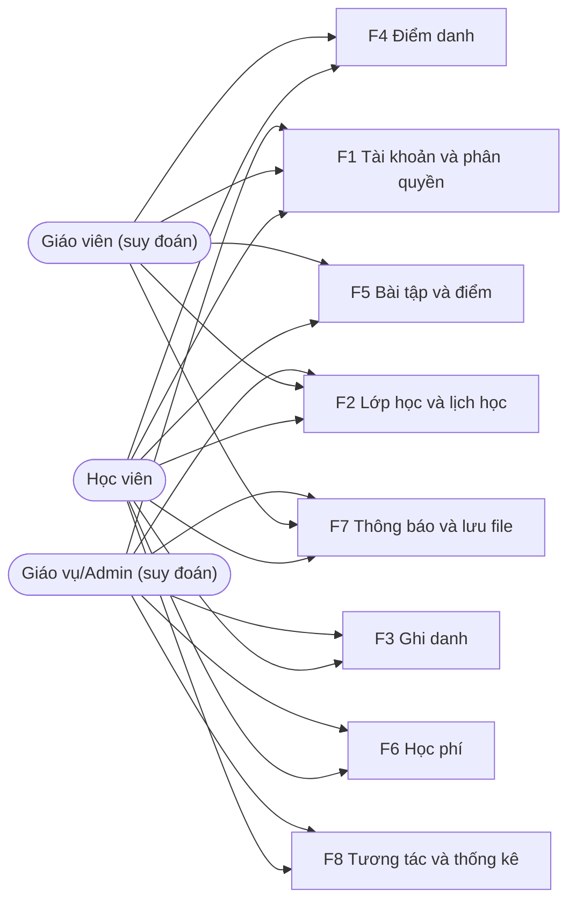

## 7. Ngoài phạm vi

Các mục sau đã được cắt khỏi phạm vi (backlog mục 6), không có nút chức năng trong sơ đồ ở trên:

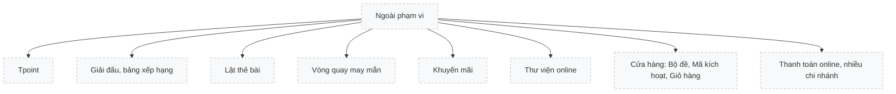

Xu chỉ ở mức Could (F3.5), không nằm trong nhánh này.
