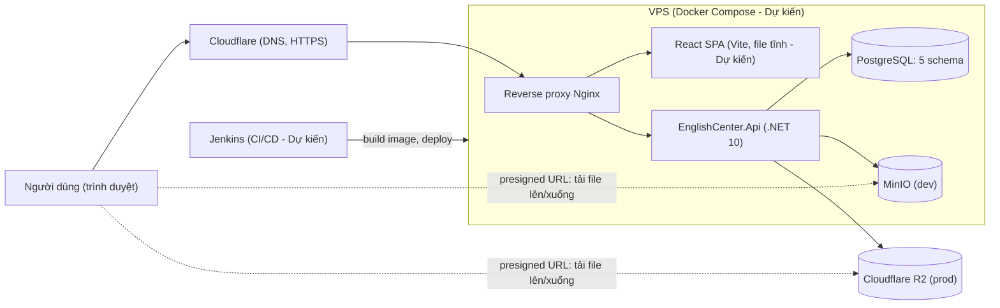
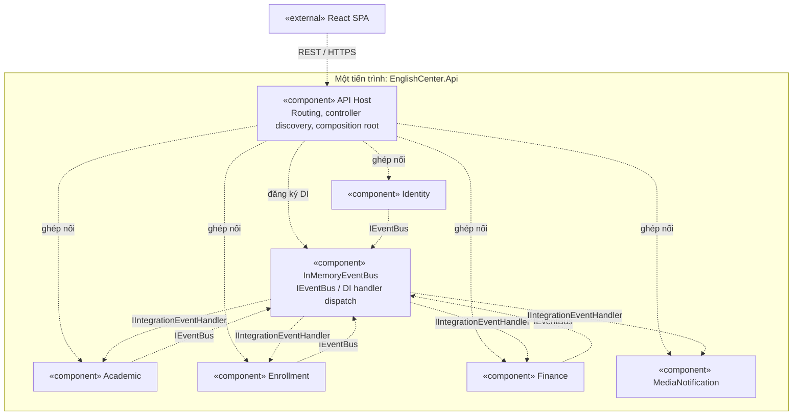
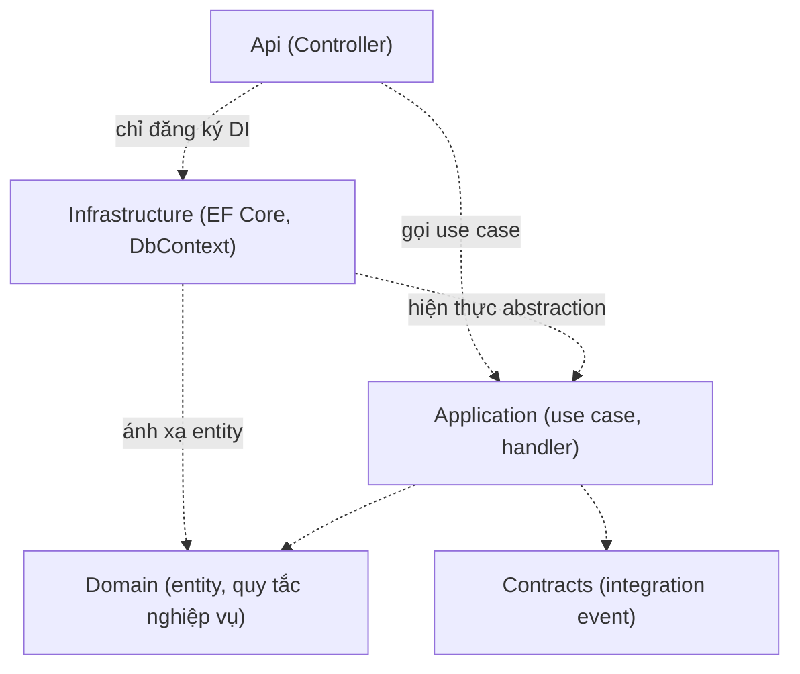
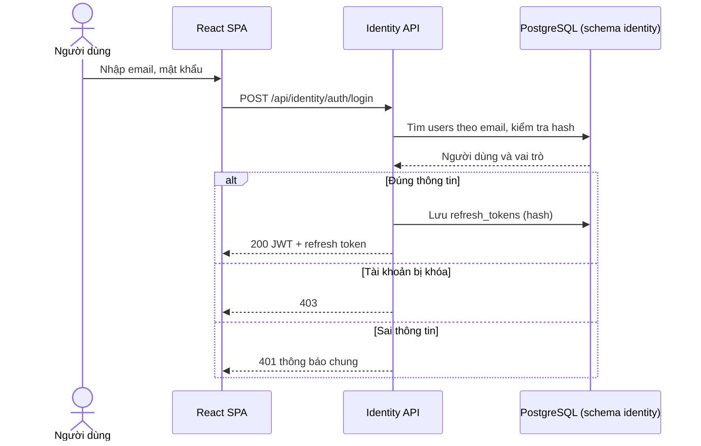
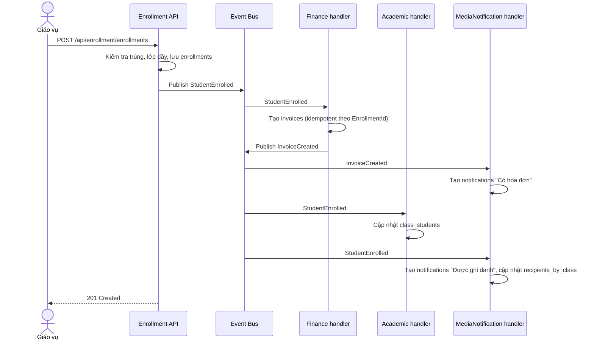
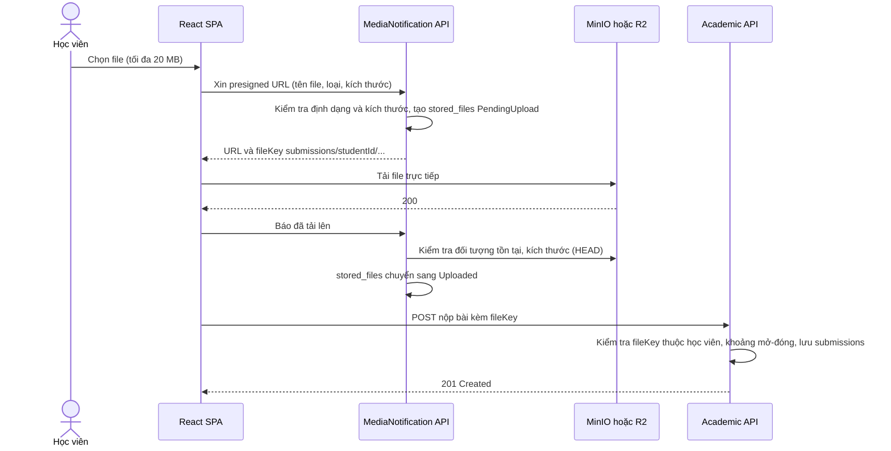
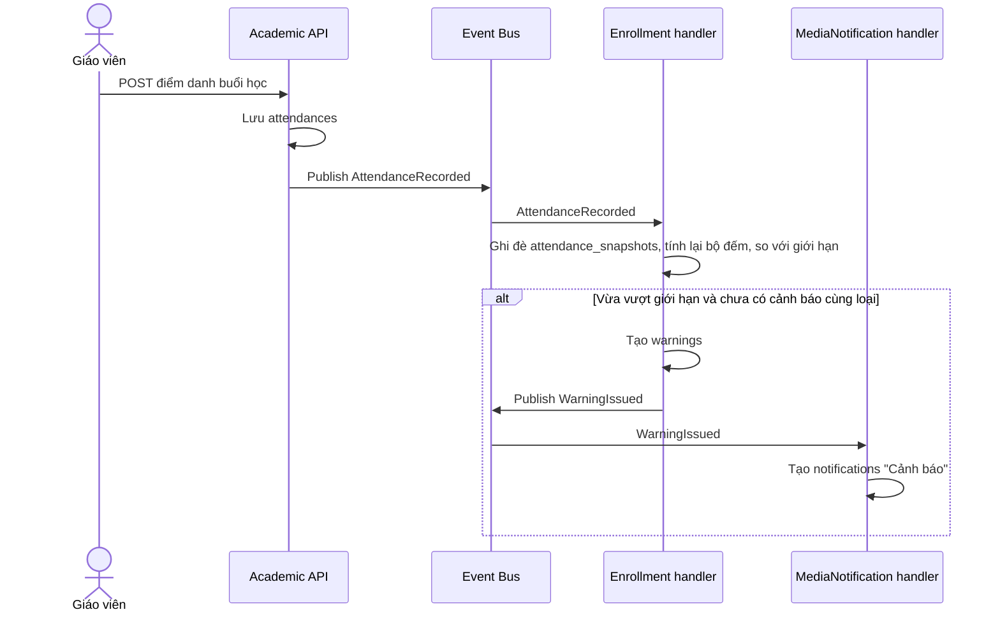
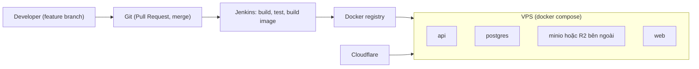

# Thiết kế hệ thống

Nhóm 10 - Môn 608819 - Phát triển ứng dụng phía máy chủ nâng cao (lớp 68CS1&2)
Phiên bản: v0.2 - bản hiệu chỉnh báo cáo. Ngày: 2026-10-22.
Nguồn dữ liệu: `CLAUDE.md`, `docs/product-backlog.md`, mã nguồn trong `src/` và `tests/` (gồm `tests/EnglishCenter.ArchitectureTests/ModuleArchitectureTests.cs`), `Directory.Packages.props`, `Directory.Build.props`, `global.json`.

Quy ước trạng thái: "Đã có" = có trong code hiện tại; "Dự kiến" = sprint sau.

## 1. Mục tiêu thiết kế và lý do chọn Modular Monolith

Nguồn: `CLAUDE.md`.

| Tiêu chí | Monolith truyền thống | Modular Monolith (chọn) | Microservices |
|---|---|---|---|
| Độ phức tạp vận hành | Thấp | Thấp (một tiến trình, một lệnh `docker compose up`) | Cao (nhiều service, mạng, giám sát) |
| Ranh giới nghiệp vụ | Dễ bị xóa nhòa, ai cũng gọi được ai | Rõ ràng, được máy kiểm tra (architecture test) | Rõ ràng |
| Làm việc song song 5 người | Dễ xung đột | Mỗi người một module, một nhánh | Phù hợp nhưng tốn hạ tầng |
| Tách dịch vụ về sau | Khó | Dễ, vì module chỉ giao tiếp qua event/contract | Đã tách |
| Phù hợp quy mô đồ án | Có | Có | Quá nặng |

Mục tiêu: 5 module độc lập (Identity, Academic, Enrollment, Finance, MediaNotification), mỗi module có Clean Architecture riêng, DbContext và schema riêng, giao tiếp bằng integration event qua Event Bus in-memory.

## 2. Kiến trúc tổng thể (mức container)

Nguồn: `CLAUDE.md` (hạ tầng), file Excel đăng ký nhóm (Cloudflare, VPS, R2). Toàn bộ sơ đồ dưới đây là Dự kiến, trừ API .NET (khung Đã có). Reverse proxy dùng Nginx; frontend chạy trong container riêng.

Ghi chú: nét đứt là đường truyền file trực tiếp giữa trình duyệt và object storage, không đi qua API.

## 3. Sơ đồ thành phần bên trong API

Năm module nằm trong **cùng một tiến trình ASP.NET Core**, không phải năm microservice. Sơ đồ thể hiện thành phần logic và quan hệ phụ thuộc, không trộn với luồng sự kiện hay tham chiếu project. Host là composition root: đăng ký DI, ghép controller và Event Bus.

Ký hiệu: `«component»` là thành phần; dependency nét đứt hướng từ bên sử dụng tới bên cung cấp. Mermaid không hỗ trợ đầy đủ UML component (cổng, ball/socket), nên hình dùng nhãn stereotype và dependency có tên; giao diện được liệt kê trong bảng.

| Thành phần | Giao diện cung cấp | Phụ thuộc sử dụng |
|---|---|---|
| API Host | Điểm vào HTTP, health, Swagger ở development | Hàm đăng ký 5 module và Event Bus |
| Identity | REST `/api/identity`, Contracts sự kiện người dùng | IEventBus; persistence Identity |
| Academic | REST `/api/academic`, Contracts học vụ, handler sự kiện nhận | IEventBus; persistence Academic |
| Enrollment | REST `/api/enrollment`, Contracts ghi danh/cảnh báo, handler sự kiện nhận | IEventBus; persistence Enrollment |
| Finance | REST `/api/finance`, Contracts hóa đơn, handler sự kiện nhận | IEventBus; persistence Finance |
| MediaNotification | REST `/api/media-notification`, handler sự kiện nhận | Persistence MediaNotification; wrapper object storage |
| InMemoryEventBus | IEventBus.PublishAsync | IIntegrationEventHandler của bên nhận, resolve qua DI |

**Trạng thái:** giao diện nghiệp vụ là Dự kiến; hiện mới có khung module, ping, Event Bus và handler Finance mẫu. Bus chỉ phụ thuộc abstraction handler chung, không tham chiếu project module; DI cung cấp hiện thực lúc chạy. Danh sách event cụ thể ở mục 6. Contracts là kiểu dữ liệu công khai lúc biên dịch, không phải thành phần chạy để chuyển event.

Mỗi module chứa Api, Application, Domain, Infrastructure và Contracts. Infrastructure sở hữu DbContext và chỉ truy cập schema của module mình: `identity`, `academic`, `enrollment`, `finance`, `media_notification` (Đã có DbContext rỗng). PostgreSQL và object storage là hạ tầng ngoài tiến trình, thể hiện ở mục 2. Không có truy cập chéo schema hay gọi trực tiếp nội bộ module khác. Luồng event nằm riêng ở mục 7; tham chiếu project nằm riêng ở mục 4.

## 4. Phụ thuộc project trong một module (Clean Architecture)

Nguồn: `CLAUDE.md`, `tests/EnglishCenter.ArchitectureTests/ModuleArchitectureTests.cs`, `Directory.Build.props`.

Mũi tên ở hình này là phụ thuộc lúc biên dịch. Controller chỉ gọi Application; cạnh Api → Infrastructure chỉ dùng trong hàm đăng ký module, không cho phép controller dùng DbContext. BuildingBlocks được lược bỏ khỏi hình; ma trận sau là đầy đủ.

### 4.1 Ma trận tham chiếu được phép

| Project | Được tham chiếu tới |
|---|---|
| BuildingBlocks | (không project nào) |
| `<M>.Domain` | BuildingBlocks |
| `<M>.Contracts` | BuildingBlocks |
| `<M>.Application` | `<M>.Domain`, `<M>.Contracts`, BuildingBlocks, `<N>.Contracts` của module khác (chỉ khi cần xử lý event của N) |
| `<M>.Infrastructure` | `<M>.Application`, `<M>.Domain`, BuildingBlocks (+ gói EF Core/Npgsql) |
| `<M>.Api` | `<M>.Application`, `<M>.Infrastructure` (chỉ để đăng ký DI trong `<M>Module.cs`), BuildingBlocks |
| EnglishCenter.Api (host) | BuildingBlocks, 5 project `<M>.Api` |
| Tests | Tự do |

### 4.2 Điều cấm

- Project của module M tham chiếu Domain/Application/Infrastructure/Api của module N khác.
- Contracts tham chiếu Domain; event chỉ dùng kiểu nguyên thủy (Guid, string, decimal, DateTime, DateOnly, int), không dùng enum/entity của Domain.
- Domain/Application tham chiếu EF Core hoặc ASP.NET Core.
- Controller dùng trực tiếp DbContext hay kiểu trong namespace `*.Infrastructure`.

Ranh giới được giữ bằng architecture test (NetArchTest.Rules kết hợp kiểm tra `ProjectReference` trong csproj) và cấu hình `DisableTransitiveProjectReferences` cho project trong `src/Modules` (Đã có).

## 5. Trách nhiệm từng module

Nguồn: backlog mục 3, 9. Endpoint chính là Dự kiến theo REST; tiền tố khớp ping hiện có (Đã có chỉ `GET .../ping`). Cột "Nhận event" gồm cả các đăng ký bổ sung ngoài backlog mục 9 (giải thích ở mục 6).

| Module | Trách nhiệm | Schema | Phát event | Nhận event | Endpoint chính (Dự kiến) |
|---|---|---|---|---|---|
| Identity | Tài khoản, đăng nhập, vai trò, hồ sơ | `identity` | `UserRegistered` | (không) | `/api/identity/auth/login`, `/auth/logout`, `/auth/change-password`, `/users`, `/users/me` |
| Academic | Lớp, buổi học, điểm danh, bài tập, bài nộp, điểm, luyện tập | `academic` | `ClassCreated`, `AttendanceRecorded`, `AssignmentPublished`, `AssignmentMissed`, `SubmissionGraded` | `StudentEnrolled`, `UserRegistered` | `/api/academic/classes`, `/sessions`, `/attendances`, `/assignments`, `/submissions` |
| Enrollment | Ghi danh, giới hạn vi phạm, cảnh báo, hẹn test | `enrollment` | `StudentEnrolled`, `WarningIssued` | `ClassCreated`, `AttendanceRecorded`, `AssignmentMissed`, `UserRegistered` | `/api/enrollment/enrollments`, `/warnings`, `/placement-tests` |
| Finance | Học phí, hóa đơn đơn giản | `finance` | `InvoiceCreated`, `InvoicePaid` | `StudentEnrolled` | `/api/finance/invoices` |
| MediaNotification | Lưu file (presigned URL), thông báo, phản hồi, FAQ, bảng tin | `media_notification` | (không) | `UserRegistered`, `StudentEnrolled`, `AssignmentPublished`, `SubmissionGraded`, `InvoiceCreated`, `InvoicePaid`, `WarningIssued` | `/api/media-notification/files/presign`, `/notifications`, `/feedbacks` |

## 6. Giao tiếp giữa module

Nguồn: `src/BuildingBlocks/EnglishCenter.BuildingBlocks` (`IEventBus`, `InMemoryEventBus`, `IIntegrationEventHandler`), tiêu chí TS-02.

In-memory Event Bus (Đã có):
- Publish không có handler không gây lỗi.
- Nhiều handler của cùng một event được gọi tuần tự theo thứ tự đăng ký.
- Handler lỗi được log và không chặn handler khác.
- Mỗi lần publish dùng một scope DI mới.
- Lỗi trong handler chỉ được log, không retry; event đó coi như đã xử lý xong với handler lỗi.
- Quy ước cho handler (không phải tính năng của bus): viết idempotent để nhận trùng event không tạo bản ghi thứ hai.

Mọi event kế thừa `IntegrationEvent`, tự có thêm hai trường `EventId` (Guid) và `OccurredOnUtc` (DateTime). Trong bảng dưới, "Dữ liệu chính" chép đúng từ các file `*IntegrationEvent.cs` trong thư mục `Contracts/IntegrationEvents/` của từng module.

| Event | Phát bởi | Nhận bởi | Dữ liệu chính | Trạng thái |
|---|---|---|---|---|
| `UserRegistered` | Identity | Enrollment, MediaNotification, Academic | `UserId` Guid, `Email` string, `FullName` string, `Role` string | Đã có (Contracts); chưa có handler |
| `ClassCreated` | Academic | Enrollment | `ClassId` Guid, `ClassCode` string, `StartDate` DateOnly, `EndDate` DateOnly, `MaxStudents` int, `TuitionFee` decimal, `ClassType` string | Đã có (Contracts); chưa có handler |
| `StudentEnrolled` | Enrollment | Finance, Academic, MediaNotification | `EnrollmentId` Guid, `StudentId` Guid, `ClassId` Guid, `TuitionFee` decimal, `EnrolledAtUtc` DateTime | Đã có (Contracts); handler Finance mẫu Đã có (ghi nhận vào bộ nhớ, chưa có bảng thật) |
| `AttendanceRecorded` | Academic | Enrollment | `SessionId` Guid, `ClassId` Guid, `StudentId` Guid, `Status` string (tên trạng thái, không dùng enum Domain), `RecordedAtUtc` DateTime | Đã có (Contracts); chưa có handler |
| `AssignmentPublished` | Academic | MediaNotification | `AssignmentId` Guid, `ClassId` Guid, `Title` string, `OpensAtUtc` DateTime, `ClosesAtUtc` DateTime | Đã có (Contracts); chưa có handler |
| `AssignmentMissed` | Academic | Enrollment | `AssignmentId`, `ClassId`, `StudentId` | Dự kiến, chưa có file Contracts |
| `SubmissionGraded` | Academic | MediaNotification | `SubmissionId` Guid, `AssignmentId` Guid, `StudentId` Guid, `Score` decimal | Đã có (Contracts); chưa có handler |
| `InvoiceCreated` | Finance | MediaNotification | `InvoiceId` Guid, `EnrollmentId` Guid, `StudentId` Guid, `Amount` decimal, `DueDate` DateOnly | Đã có (Contracts); chưa có handler |
| `InvoicePaid` | Finance | MediaNotification | `InvoiceId`, `EnrollmentId`, `StudentId`, `PaidAtUtc` | Dự kiến, chưa có file Contracts |
| `WarningIssued` | Enrollment | MediaNotification | `WarningId`, `EnrollmentId`, `StudentId`, `ClassId`, `WarningType` | Dự kiến, chưa có file Contracts |

Việc Academic và MediaNotification nhận `StudentEnrolled` đã có trong backlog mục 9. Phần thiết kế bổ sung so với backlog:
- Academic nhận `UserRegistered` (để có tên giáo viên trong `teachers`); đây là đăng ký event mới so với backlog.
- Các bảng read model do `StudentEnrolled`/`ClassCreated`/`AttendanceRecorded` cập nhật: `academic.class_students`, `media_notification.recipients_by_class` (để gửi `AssignmentPublished` tới cả lớp), `enrollment.class_snapshots`, `enrollment.attendance_snapshots`. Event đã có trong backlog, chỉ bảng là mới.
- MediaNotification dùng `UserRegistered` để tạo thông báo chào mừng loại `Welcome`.
- Chưa có event khi người dùng đổi tên/email (kiểu `UserProfileUpdated`); bản sao dữ liệu có thể lệch cho tới khi bổ sung.
- Enrollment nhận `UserRegistered` (đã có trong backlog) để dựng read model `enrollment.students`; xem tài liệu 04.

## 7. Luồng tương tác chính

### 7.1 Đăng nhập (Dự kiến)

### 7.2 Ghi danh, hóa đơn, thông báo (Dự kiến, handler Finance mẫu Đã có)

Thứ tự minh họa: Event Bus publish đồng bộ và lồng nhau, nên thứ tự chạy thật có thể khác (ví dụ `InvoiceCreated` được xử lý ngay bên trong handler Finance, trước khi các handler `StudentEnrolled` còn lại chạy). Kết quả cuối cùng không phụ thuộc thứ tự.

Nếu một handler lỗi, bus chỉ log và bỏ qua; ghi danh vẫn trả 201 (xem mục 11).

### 7.3 Nộp bài có file qua presigned URL (Dự kiến)

Cách thực hiện:
- Chặn file lớn hơn 20 MB và sai định dạng: MediaNotification kiểm tra tên/loại/kích thước khai báo trước khi cấp URL; dùng presigned POST với điều kiện `content-length-range` (nếu SDK/nhà cung cấp hỗ trợ) hoặc kiểm tra bằng HEAD sau khi tải lên và xóa file vi phạm. Định dạng cho phép: pdf, docx, mp3, m4a, jpg, png.
- Academic kiểm tra `fileKey` thuộc đúng học viên mà không đọc schema `media_notification`: quy ước khóa `submissions/{studentId}/{uuid}.{ext}` và so khớp `studentId` với JWT. Phương án khác: MediaNotification phát event khi file `Uploaded` (chưa có Contracts).
- `stored_files` chuyển `PendingUpload` sang `Uploaded` khi client gọi bước báo đã tải lên và HEAD thành công (hoặc khi nhận thông báo sự kiện từ object storage nếu cấu hình được).

### 7.4 Điểm danh và cảnh báo (Dự kiến)

### 7.5 Thống kê cá nhân (Dự kiến)

Frontend gọi API của Academic, Enrollment, MediaNotification rồi tổng hợp phía client; không có truy vấn join chéo schema.

## 8. Bảo mật

Nguồn: backlog US-01..06, US-20, US-27, `CLAUDE.md`. Toàn bộ là Dự kiến.

- JWT Bearer với claim `sub`, `role`; refresh token lưu dạng hash, thu hồi khi đăng xuất/đổi mật khẩu.
- Phân quyền theo vai trò: 401 khi thiếu token, 403 khi thiếu quyền.
- Presigned URL có hạn dùng; access key của MinIO/R2 chỉ nằm trong cấu hình phía server.
- Secret qua biến môi trường, không commit vào repo.
- CORS chỉ cho domain frontend; HTTPS qua Cloudflare (Cloudflare Edge đến VPS dùng Origin CA Certificate theo yêu cầu trong file đăng ký nhóm `.xlsx`).

## 9. Công nghệ

Nguồn: `Directory.Packages.props`, `Directory.Build.props`, `global.json`.

| Hạng mục | Công nghệ | Phiên bản | Trạng thái |
|---|---|---|---|
| Nền tảng | .NET / ASP.NET Core | `net10.0`, SDK 10.0.400 | Đã có |
| ORM | Microsoft.EntityFrameworkCore, .Relational | 10.0.0 | Đã có |
| Provider CSDL | Npgsql.EntityFrameworkCore.PostgreSQL | 10.0.0 | Đã có |
| API docs | Swashbuckle.AspNetCore | 9.0.6 | Đã có |
| Architecture test | NetArchTest.Rules | 1.3.2 | Đã có |
| Unit test | xunit, xunit.runner.visualstudio, Microsoft.NET.Test.Sdk | 2.9.3, 3.1.5, 17.14.1 | Đã có |
| Integration test | Microsoft.AspNetCore.Mvc.Testing | 10.0.0 | Đã có |
| Cơ sở dữ liệu | PostgreSQL | bản 16 hoặc 17 | Dự kiến |
| Xác thực | Microsoft.AspNetCore.Authentication.JwtBearer | Chọn khi tích hợp | Dự kiến |
| Lưu file | MinIO (dev), Cloudflare R2 (prod); SDK AWSSDK.S3 (đã chốt, dùng chung cho cả hai) | sẽ chọn bản ổn định mới nhất khi thêm gói | Dự kiến |
| Frontend | React + Vite + TypeScript | Chọn khi tích hợp | Dự kiến |
| Đóng gói | Docker + Docker Compose (multi-stage) | Chọn khi tích hợp | Dự kiến |
| CI/CD | Jenkins (Jenkinsfile) | Chọn khi tích hợp | Dự kiến |
| Hạ tầng | VPS Linux, Cloudflare DNS/HTTPS, reverse proxy Nginx | - | Dự kiến |

Ghi chú giấy phép: không dùng các bản thương mại MediatR 13+, FluentAssertions 8+, AutoMapper 15+.

## 10. Triển khai

Nguồn: `CLAUDE.md`, backlog TS-05, TS-06. Toàn bộ là Dự kiến (chưa có Dockerfile, docker-compose, Jenkinsfile).

## 11. Hạn chế và hướng mở rộng

- Event Bus in-memory không bền: mất event nếu tiến trình dừng giữa chừng. Hướng nâng cấp: Outbox pattern, sau đó message broker.
- Xử lý event đồng bộ trong cùng request; handler chậm làm chậm request phát event.
- Nhất quán cuối cùng giữa bản sao dữ liệu (read model) và nguồn.
- InMemoryEventBus bắt lỗi handler chỉ để log, không retry. Hệ quả: nếu handler Finance lỗi, ghi danh vẫn thành công nhưng thiếu hóa đơn. Hướng khắc phục dự kiến: Outbox + retry, hoặc job đối soát.
- Sửa điểm danh trong 24h phát lại `AttendanceRecorded` với `EventId` mới, nên Enrollment không được cộng dồn bộ đếm; thiết kế lưu trạng thái mới nhất trong `enrollment.attendance_snapshots` và tính lại (tài liệu 04 mục 6.1).
- Backlog chỉ có tạo lớp (US-07), chưa có sửa lớp. Hiện không có chức năng sửa lớp; nếu sau này bổ sung thì cần thêm event cập nhật `enrollment.class_snapshots`.
- Có thể tách module thành service riêng vì ranh giới đã đi qua contract và event.

## 12. Quản lý tiến độ

Dự kiến dùng Jira từ giai đoạn code (backlog và sprint chuyển từ `docs/product-backlog.md` sang Jira).
