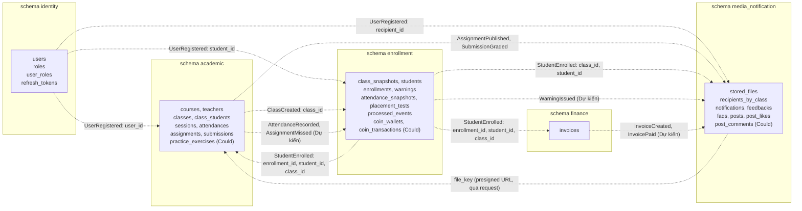
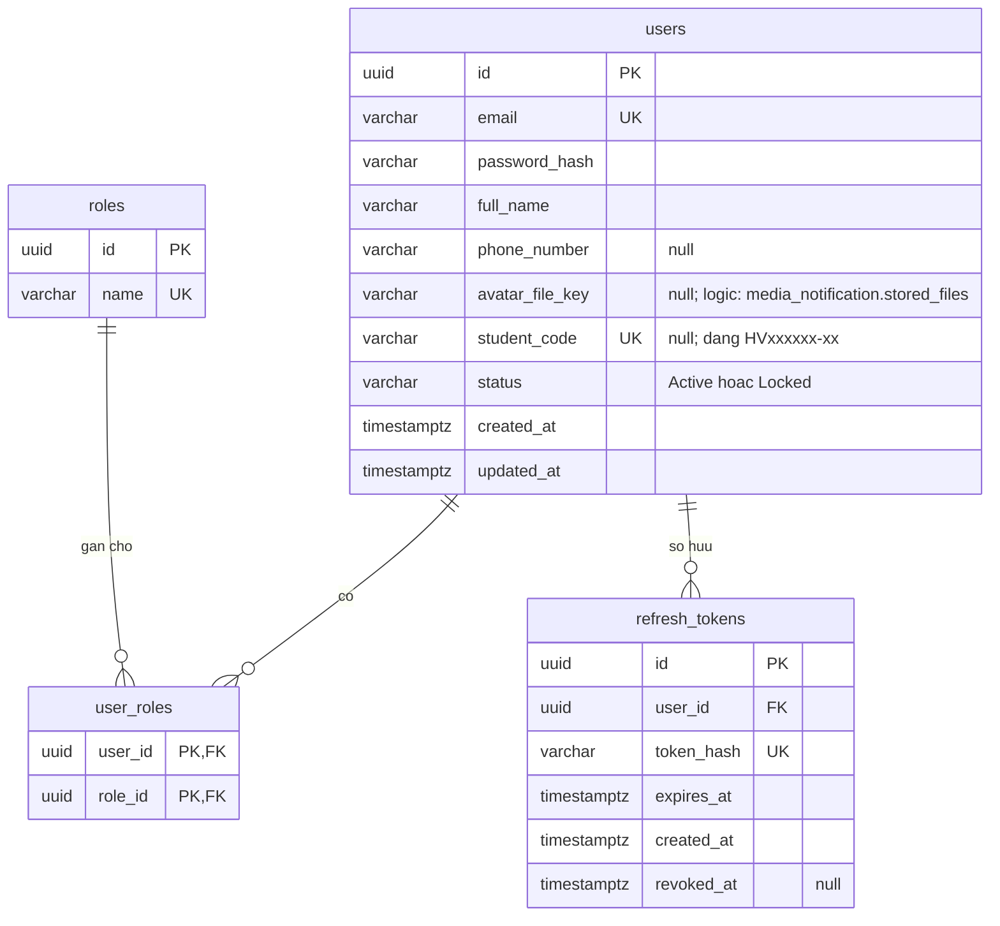
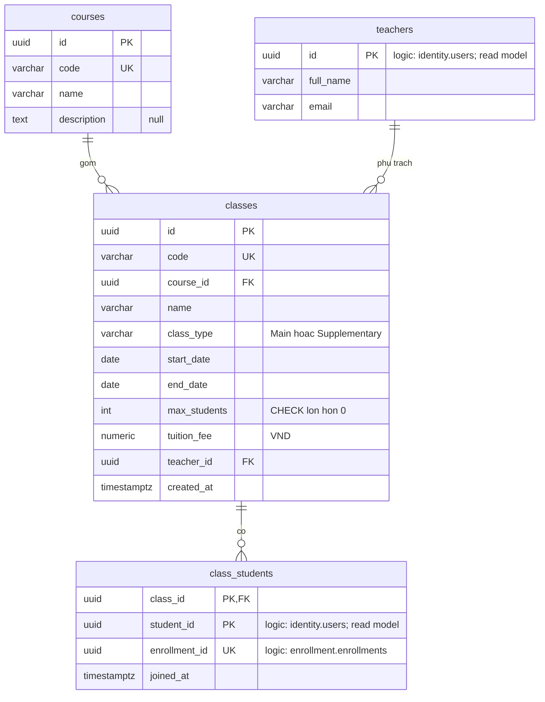
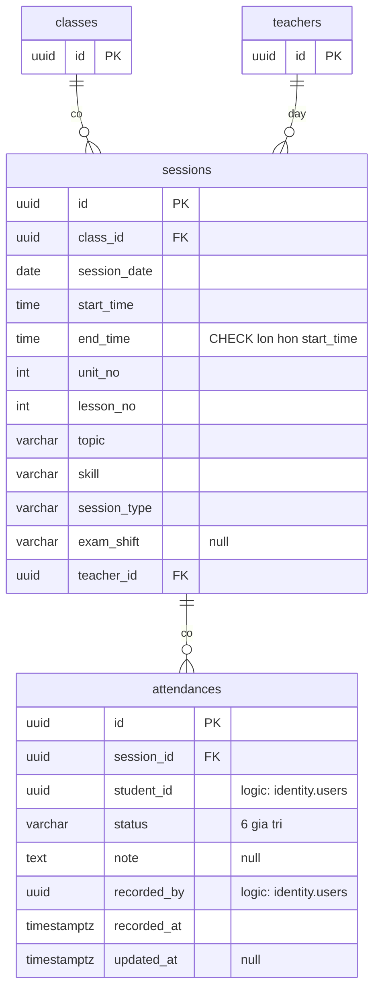
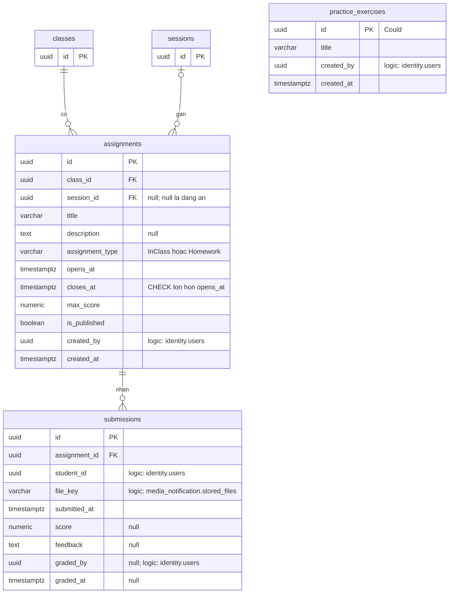
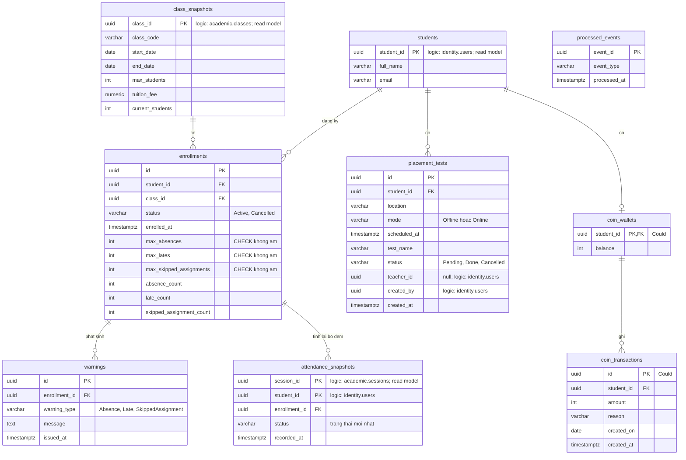
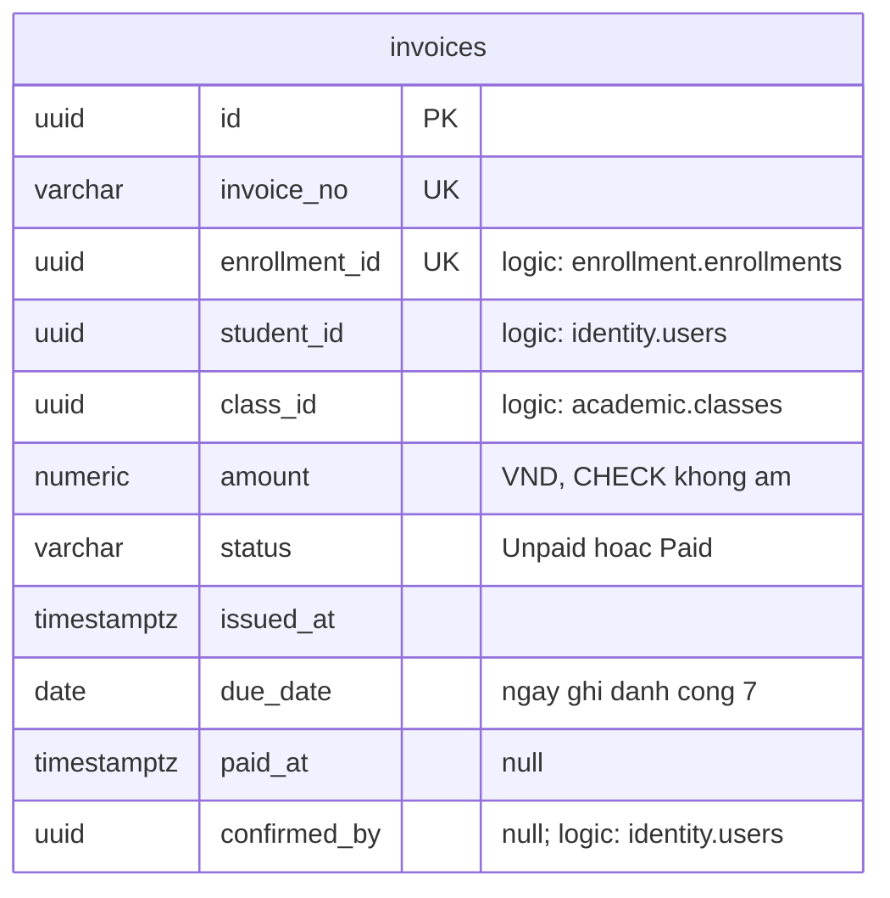
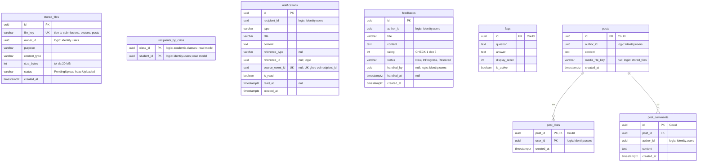

# Thiết kế cơ sở dữ liệu

Nhóm 10 - Môn 608819 - Phát triển ứng dụng phía máy chủ nâng cao (lớp 68CS1&2)
Phiên bản: v0.1 - bản báo cáo tuần. Ngày: 2026-10-17.
Nguồn dữ liệu: `docs/product-backlog.md` (tiêu chí chấp nhận), ảnh tham khảo 01, 03, 04, 10, 11, 13, 14, 16, 19, 21 trong `lms-tiw-anh-chup/`, `CLAUDE.md`, event trong `src/Modules/*/...Contracts/IntegrationEvents/`, `AttendanceStatus.cs`.

Trạng thái: hiện mới có 5 `DbContext` rỗng với schema riêng (Đã có). Toàn bộ bảng, cột, migration trong tài liệu này là thiết kế, Dự kiến (chưa triển khai). Các bảng read model (`academic.teachers`, `academic.class_students`, `enrollment.class_snapshots`, `enrollment.attendance_snapshots`, `enrollment.students`, `media_notification.recipients_by_class`) và việc Academic nhận `UserRegistered` là thiết kế bổ sung so với `docs/product-backlog.md`.

## 1. Nguyên tắc

- Một PostgreSQL database, 5 schema: `identity`, `academic`, `enrollment`, `finance`, `media_notification`. Mỗi schema do đúng 1 `DbContext` quản lý; bảng `__EFMigrationsHistory` nằm trong schema riêng.
- Khóa ngoại (FK) chỉ tồn tại trong cùng schema. Tham chiếu sang module khác là tham chiếu logic: cột `*_id` kiểu `uuid`, không có ràng buộc FK; giá trị đến từ integration event hoặc từ request đã xác thực (JWT, presigned URL).
- Dữ liệu cần từ module khác được lưu dưới dạng bản sao chỉ đọc (read model/snapshot). Bảng đó thuộc sở hữu của module chứa nó, chỉ được ghi bởi handler event của chính module đó, không module nào khác đọc hay ghi. Chấp nhận nhất quán cuối cùng (eventual consistency).
- Khóa chính `uuid` sinh ở ứng dụng; thời gian `timestamptz` UTC; tiền VND số nguyên, `numeric(12,0)`; enum lưu `varchar` bằng tên tiếng Anh.
- Không join, view hay truy vấn chéo schema.
- Quy ước đặt tên: bảng và cột `snake_case` tiếng Anh. Trong ERD, kiểu `numeric` được ghi không kèm độ chính xác (Mermaid không nhận khoảng trắng); độ chính xác ghi ở bảng mô tả.

## 2. Sơ đồ tổng quan tham chiếu logic giữa 5 schema

Nét liền = FK thật (chỉ trong schema, xem các ERD bên dưới). Nét đứt = ID logic, không FK, đồng bộ bằng integration event. Nhãn ghi tên event.

## 3. ERD từng schema

Chú thích ERD: `PK` khóa chính, `FK` khóa ngoại trong cùng schema, `UK` unique. Cột tham chiếu sang module khác không có nhãn FK và có chú thích "logic: schema.bảng".

### 3.1 Schema `identity`

`users` (Dự kiến):

| Cột | Kiểu | Khóa | Null | Mô tả / Ràng buộc |
|---|---|---|---|---|
| `id` | uuid | PK | Không | Sinh ở ứng dụng |
| `email` | varchar(255) | UK | Không | Duy nhất; trùng trả 409 |
| `password_hash` | varchar(255) | | Không | Chỉ lưu hash (thuật toán chọn ở NFR-05), không trả về API |
| `full_name` | varchar(200) | | Không | Họ tên |
| `phone_number` | varchar(20) | | Có | Số điện thoại |
| `avatar_file_key` | varchar(500) | | Có | Logic: `media_notification.stored_files.file_key`; không FK |
| `student_code` | varchar(20) | UK | Có | Dạng `HVxxxxxx-xx`, chỉ học viên, chỉ đọc |
| `status` | varchar(20) | | Không | `Active` (Hoạt động) / `Locked` (Bị khóa) |
| `created_at` | timestamptz | | Không | UTC |
| `updated_at` | timestamptz | | Không | UTC |

`roles` (Dự kiến):

| Cột | Kiểu | Khóa | Null | Mô tả / Ràng buộc |
|---|---|---|---|---|
| `id` | uuid | PK | Không | |
| `name` | varchar(50) | UK | Không | `Student`, `Teacher`, `Staff` (gộp Giáo vụ và Admin) |

`user_roles` (Dự kiến):

| Cột | Kiểu | Khóa | Null | Mô tả / Ràng buộc |
|---|---|---|---|---|
| `user_id` | uuid | PK, FK | Không | FK tới `users.id` |
| `role_id` | uuid | PK, FK | Không | FK tới `roles.id` |

`refresh_tokens` (Dự kiến):

| Cột | Kiểu | Khóa | Null | Mô tả / Ràng buộc |
|---|---|---|---|---|
| `id` | uuid | PK | Không | |
| `user_id` | uuid | FK | Không | FK tới `users.id` |
| `token_hash` | varchar(255) | UK | Không | Lưu hash, không lưu token gốc |
| `expires_at` | timestamptz | | Không | Hạn dùng |
| `created_at` | timestamptz | | Không | |
| `revoked_at` | timestamptz | | Có | Có giá trị = đã thu hồi (đăng xuất, đổi mật khẩu) |

### 3.2 Schema `academic`

Buổi học và điểm danh (hai bảng `classes`, `teachers` chỉ nhắc lại để thể hiện quan hệ):

Bài tập, nộp bài và bài luyện tập (hai bảng `classes`, `sessions` chỉ nhắc lại để thể hiện quan hệ, thuộc tính xem sơ đồ trên):

Mô tả bảng (Dự kiến).

`courses`:

| Cột | Kiểu | Khóa | Null | Mô tả / Ràng buộc |
|---|---|---|---|---|
| `id` | uuid | PK | Không | |
| `code` | varchar(50) | UK | Không | Mã khóa học |
| `name` | varchar(200) | | Không | Tên khóa |
| `description` | text | | Có | |

`teachers` (read model, cập nhật khi nhận `UserRegistered` với role Teacher):

| Cột | Kiểu | Khóa | Null | Mô tả / Ràng buộc |
|---|---|---|---|---|
| `id` | uuid | PK | Không | Bằng `identity.users.id` (logic, không FK) |
| `full_name` | varchar(200) | | Không | Bản sao từ event |
| `email` | varchar(255) | | Không | Bản sao từ event |

`classes`:

| Cột | Kiểu | Khóa | Null | Mô tả / Ràng buộc |
|---|---|---|---|---|
| `id` | uuid | PK | Không | |
| `code` | varchar(50) | UK | Không | Mã lớp duy nhất |
| `course_id` | uuid | FK | Không | FK tới `courses.id` |
| `name` | varchar(200) | | Không | |
| `class_type` | varchar(20) | | Không | `Main` (Lớp chính) / `Supplementary` (Lớp bổ trợ) |
| `start_date` | date | | Không | |
| `end_date` | date | | Không | CHECK `end_date > start_date` |
| `max_students` | int | | Không | CHECK `max_students > 0` |
| `tuition_fee` | numeric(12,0) | | Không | Học phí VND, CHECK `>= 0` |
| `teacher_id` | uuid | FK | Không | FK tới `teachers.id` (cùng schema) |
| `created_at` | timestamptz | | Không | |

Trạng thái lớp (Sắp diễn ra / Đang diễn ra / Kết thúc) được suy ra từ ngày, không lưu.

`class_students` (read model, cập nhật khi nhận `StudentEnrolled`):

| Cột | Kiểu | Khóa | Null | Mô tả / Ràng buộc |
|---|---|---|---|---|
| `class_id` | uuid | PK, FK | Không | FK tới `classes.id` |
| `student_id` | uuid | PK | Không | Logic: `identity.users.id`; không FK |
| `enrollment_id` | uuid | UK | Không | Logic: `enrollment.enrollments.id`; không FK |
| `joined_at` | timestamptz | | Không | Lấy từ `EnrolledAtUtc` |

`sessions`:

| Cột | Kiểu | Khóa | Null | Mô tả / Ràng buộc |
|---|---|---|---|---|
| `id` | uuid | PK | Không | |
| `class_id` | uuid | FK | Không | FK tới `classes.id`; ngày nằm trong khoảng ngày của lớp |
| `session_date` | date | | Không | |
| `start_time` | time | | Không | |
| `end_time` | time | | Không | CHECK `end_time > start_time` |
| `unit_no` | int | | Không | Unit (Unit và Lesson là cột của `sessions`) |
| `lesson_no` | int | | Không | Lesson |
| `topic` | varchar(300) | | Không | Chủ đề |
| `skill` | varchar(20) | | Không | `Listening`, `Reading`, `Writing`, `Speaking` |
| `session_type` | varchar(20) | | Không | `Regular` (thường), `MockTest`, `FinalTest` |
| `exam_shift` | varchar(20) | | Có | Ca thi (Ca 1 / Ca 2) |
| `teacher_id` | uuid | FK | Không | FK tới `teachers.id`; không trùng giờ với buổi khác |

`attendances`:

| Cột | Kiểu | Khóa | Null | Mô tả / Ràng buộc |
|---|---|---|---|---|
| `id` | uuid | PK | Không | |
| `session_id` | uuid | FK | Không | FK tới `sessions.id`; UK (`session_id`, `student_id`) |
| `student_id` | uuid | | Không | Logic: `identity.users.id` |
| `status` | varchar(20) | | Không | 6 giá trị, xem mục 6 |
| `note` | text | | Có | |
| `recorded_by` | uuid | | Không | Logic: `identity.users.id` (giáo viên, lấy từ JWT) |
| `recorded_at` | timestamptz | | Không | |
| `updated_at` | timestamptz | | Có | Sửa trong 24h sau buổi học |

`assignments`:

| Cột | Kiểu | Khóa | Null | Mô tả / Ràng buộc |
|---|---|---|---|---|
| `id` | uuid | PK | Không | |
| `class_id` | uuid | FK | Không | FK tới `classes.id` |
| `session_id` | uuid | FK | Có | FK tới `sessions.id`; null = đang ẩn do chưa gán buổi |
| `title` | varchar(300) | | Không | |
| `description` | text | | Có | |
| `assignment_type` | varchar(20) | | Không | `InClass` (Trên lớp) / `Homework` (Về nhà) |
| `opens_at` | timestamptz | | Không | |
| `closes_at` | timestamptz | | Không | CHECK `closes_at > opens_at` |
| `max_score` | numeric(4,2) | | Không | Thang điểm 0-10 |
| `is_published` | boolean | | Không | Công bố thì phát `AssignmentPublished` |
| `created_by` | uuid | | Không | Logic: `identity.users.id` |
| `created_at` | timestamptz | | Không | |

`submissions`:

| Cột | Kiểu | Khóa | Null | Mô tả / Ràng buộc |
|---|---|---|---|---|
| `id` | uuid | PK | Không | |
| `assignment_id` | uuid | FK | Không | FK tới `assignments.id`; UK (`assignment_id`, `student_id`), nộp lại ghi đè |
| `student_id` | uuid | | Không | Logic: `identity.users.id` |
| `file_key` | varchar(500) | | Không | Logic: `media_notification.stored_files.file_key` |
| `submitted_at` | timestamptz | | Không | |
| `score` | numeric(4,2) | | Có | Điểm 0-10 |
| `feedback` | text | | Có | Nhận xét |
| `graded_by` | uuid | | Có | Logic: `identity.users.id` |
| `graded_at` | timestamptz | | Có | |

`practice_exercises` (Could):

| Cột | Kiểu | Khóa | Null | Mô tả / Ràng buộc |
|---|---|---|---|---|
| `id` | uuid | PK | Không | |
| `title` | varchar(300) | | Không | |
| `created_by` | uuid | | Không | Logic: `identity.users.id` |
| `created_at` | timestamptz | | Không | |

### 3.3 Schema `enrollment`

Các bảng Xu (`coin_wallets`, `coin_transactions`) là Could, làm nếu còn thời gian.

`attendance_snapshots` (read model, cập nhật khi nhận `AttendanceRecorded`): lưu trạng thái điểm danh mới nhất theo (`session_id`, `student_id`). Vì giáo viên được sửa điểm danh trong 24h và mỗi lần sửa phát lại `AttendanceRecorded` với `EventId` mới, Enrollment không cộng dồn bộ đếm mà ghi đè dòng này rồi tính lại `absence_count`, `late_count` bằng cách đếm theo ánh xạ ở mục 6.1.

| Cột | Kiểu | Khóa | Null | Mô tả / Ràng buộc |
|---|---|---|---|---|
| `session_id` | uuid | PK | Không | Logic: `academic.sessions.id` |
| `student_id` | uuid | PK | Không | Logic: `identity.users.id` (PK ghép với `session_id`) |
| `enrollment_id` | uuid | FK | Không | FK tới `enrollments.id` (tìm theo `student_id` + `ClassId` của event) |
| `status` | varchar(20) | | Không | 1 trong 6 trạng thái điểm danh |
| `recorded_at` | timestamptz | | Không | Lấy từ `RecordedAtUtc`; bỏ qua event cũ hơn bản đang lưu |

Chú ý: `student_id` ở bảng này là cột logic (không FK), chỉ `enrollment_id` là FK.

`class_snapshots` (read model, cập nhật khi nhận `ClassCreated`; hiện không có chức năng sửa lớp nên chưa có event cập nhật; payload của event: `ClassId`, `ClassCode`, `StartDate`, `EndDate`, `MaxStudents`, `TuitionFee`, `ClassType`):

| Cột | Kiểu | Khóa | Null | Mô tả / Ràng buộc |
|---|---|---|---|---|
| `class_id` | uuid | PK | Không | Logic: `academic.classes.id`; không FK |
| `class_code` | varchar(50) | | Không | |
| `start_date` | date | | Không | |
| `end_date` | date | | Không | |
| `max_students` | int | | Không | |
| `tuition_fee` | numeric(12,0) | | Không | Dùng làm `TuitionFee` của `StudentEnrolled` |
| `current_students` | int | | Không | Sĩ số hiện tại; Enrollment tự tăng khi ghi danh |

`students` (read model, cập nhật khi nhận `UserRegistered` với role Student; bắt buộc vì `enrollments`, `placement_tests` có FK tới bảng này):

| Cột | Kiểu | Khóa | Null | Mô tả / Ràng buộc |
|---|---|---|---|---|
| `student_id` | uuid | PK | Không | Logic: `identity.users.id` |
| `full_name` | varchar(200) | | Không | |
| `email` | varchar(255) | | Không | |

`enrollments`:

| Cột | Kiểu | Khóa | Null | Mô tả / Ràng buộc |
|---|---|---|---|---|
| `id` | uuid | PK | Không | Là `EnrollmentId` trong `StudentEnrolled` |
| `student_id` | uuid | FK | Không | FK tới `students.student_id`; UK (`student_id`, `class_id`) |
| `class_id` | uuid | FK | Không | FK tới `class_snapshots.class_id` |
| `status` | varchar(20) | | Không | `Active`, `Cancelled`. Trạng thái "hoàn thành" không lưu: tính khi truy vấn, ghi danh `Active` có `class_snapshots.end_date` đã qua, dùng cho "số lớp đã hoàn thành" ở US-29 |
| `enrolled_at` | timestamptz | | Không | |
| `max_absences` | int | | Không | Giới hạn số buổi nghỉ, CHECK `>= 0` |
| `max_lates` | int | | Không | Giới hạn số lần đi trễ, CHECK `>= 0` |
| `max_skipped_assignments` | int | | Không | Giới hạn số bài được bỏ, CHECK `>= 0` |
| `absence_count` | int | | Không | Đã dùng |
| `late_count` | int | | Không | Đã dùng |
| `skipped_assignment_count` | int | | Không | Đã dùng |

`warnings`:

| Cột | Kiểu | Khóa | Null | Mô tả / Ràng buộc |
|---|---|---|---|---|
| `id` | uuid | PK | Không | |
| `enrollment_id` | uuid | FK | Không | FK tới `enrollments.id` |
| `warning_type` | varchar(30) | | Không | `Absence`, `Late`, `SkippedAssignment` |
| `message` | text | | Không | |
| `issued_at` | timestamptz | | Không | Chỉ tạo `warnings` (và phát `WarningIssued`) khi bộ đếm vừa vượt ngưỡng và chưa có cảnh báo cùng `warning_type` cho ghi danh đó |

`placement_tests`:

| Cột | Kiểu | Khóa | Null | Mô tả / Ràng buộc |
|---|---|---|---|---|
| `id` | uuid | PK | Không | |
| `student_id` | uuid | FK | Không | FK tới `students.student_id` |
| `location` | varchar(200) | | Không | Địa điểm |
| `mode` | varchar(20) | | Không | `Offline`, `Online` |
| `scheduled_at` | timestamptz | | Không | Thời gian |
| `test_name` | varchar(200) | | Không | Tên đề |
| `status` | varchar(20) | | Không | `Pending` (Chờ kiểm tra), `Done` (Đã kiểm tra), `Cancelled` (Hủy) |
| `teacher_id` | uuid | | Có | Logic: `identity.users.id` |
| `created_by` | uuid | | Không | Logic: `identity.users.id` |
| `created_at` | timestamptz | | Không | |

`processed_events` (idempotency chung):

| Cột | Kiểu | Khóa | Null | Mô tả / Ràng buộc |
|---|---|---|---|---|
| `event_id` | uuid | PK | Không | `EventId` của integration event đã xử lý |
| `event_type` | varchar(200) | | Không | |
| `processed_at` | timestamptz | | Không | |

`coin_wallets` (Could):

| Cột | Kiểu | Khóa | Null | Mô tả / Ràng buộc |
|---|---|---|---|---|
| `student_id` | uuid | PK, FK | Không | FK tới `students.student_id` |
| `balance` | int | | Không | CHECK `>= 0` |

`coin_transactions` (Could):

| Cột | Kiểu | Khóa | Null | Mô tả / Ràng buộc |
|---|---|---|---|---|
| `id` | uuid | PK | Không | |
| `student_id` | uuid | FK | Không | FK tới `coin_wallets.student_id`; UK (`student_id`, `created_on`) để điểm danh nhận Xu mỗi ngày 1 lần |
| `amount` | int | | Không | |
| `reason` | varchar(200) | | Không | |
| `created_on` | date | | Không | Ngày phát sinh |
| `created_at` | timestamptz | | Không | |

### 3.4 Schema `finance`

Chỉ có bảng `invoices`; thu tiền thủ công nên không có bảng `payments`.

`invoices` (Dự kiến):

| Cột | Kiểu | Khóa | Null | Mô tả / Ràng buộc |
|---|---|---|---|---|
| `id` | uuid | PK | Không | Là `InvoiceId` trong `InvoiceCreated` |
| `invoice_no` | varchar(30) | UK | Không | Số hóa đơn |
| `enrollment_id` | uuid | UK | Không | Logic: `enrollment.enrollments.id`; UK đảm bảo idempotent theo `EnrollmentId` |
| `student_id` | uuid | | Không | Logic: `identity.users.id` |
| `class_id` | uuid | | Không | Logic: `academic.classes.id` |
| `amount` | numeric(12,0) | | Không | Bằng `TuitionFee` trong event; CHECK `>= 0` |
| `status` | varchar(20) | | Không | `Unpaid` (Chưa thanh toán), `Paid` (Đã thanh toán) |
| `issued_at` | timestamptz | | Không | |
| `due_date` | date | | Không | Ngày ghi danh + 7 ngày |
| `paid_at` | timestamptz | | Có | |
| `confirmed_by` | uuid | | Có | Logic: `identity.users.id` |

### 3.5 Schema `media_notification`

Các bảng `faqs`, `posts`, `post_likes`, `post_comments` là Could.

`stored_files`:

| Cột | Kiểu | Khóa | Null | Mô tả / Ràng buộc |
|---|---|---|---|---|
| `id` | uuid | PK | Không | |
| `file_key` | varchar(500) | UK | Không | Tiền tố theo loại: `submissions/`, `avatars/`, `posts/` |
| `owner_id` | uuid | | Không | Logic: `identity.users.id` |
| `purpose` | varchar(30) | | Không | Mục đích sử dụng |
| `content_type` | varchar(100) | | Không | pdf, docx, mp3, m4a, jpg, png |
| `size_bytes` | int | | Không | CHECK `<= 20971520` (20 MB) |
| `status` | varchar(20) | | Không | `PendingUpload`, `Uploaded` |
| `created_at` | timestamptz | | Không | |

`recipients_by_class` (read model, cập nhật khi nhận `StudentEnrolled`; dùng gửi thông báo `AssignmentPublished` tới cả lớp):

| Cột | Kiểu | Khóa | Null | Mô tả / Ràng buộc |
|---|---|---|---|---|
| `class_id` | uuid | PK | Không | Logic: `academic.classes.id` |
| `student_id` | uuid | PK | Không | Logic: `identity.users.id` |

`notifications`:

| Cột | Kiểu | Khóa | Null | Mô tả / Ràng buộc |
|---|---|---|---|---|
| `id` | uuid | PK | Không | |
| `recipient_id` | uuid | | Không | Logic: `identity.users.id` |
| `type` | varchar(30) | | Không | `Welcome` (tạo khi nhận `UserRegistered`), `Enrolled`, `AssignmentPublished`, `SubmissionGraded`, `InvoiceCreated`, `InvoicePaid`, `Warning` |
| `title` | varchar(200) | | Không | |
| `content` | text | | Không | |
| `reference_type` | varchar(50) | | Có | Loại đối tượng liên quan |
| `reference_id` | uuid | | Có | Logic, trỏ tới đối tượng của module khác |
| `source_event_id` | uuid | UK (ghép) | Có | `EventId` của event nguồn. UK ghép (`source_event_id`, `recipient_id`): 1 thông báo cho mỗi người nhận của mỗi event (một event như `AssignmentPublished` tạo N thông báo cùng `EventId`), nhận trùng event không tạo thêm |
| `is_read` | boolean | | Không | |
| `read_at` | timestamptz | | Có | |
| `created_at` | timestamptz | | Không | |

`feedbacks`:

| Cột | Kiểu | Khóa | Null | Mô tả / Ràng buộc |
|---|---|---|---|---|
| `id` | uuid | PK | Không | |
| `author_id` | uuid | | Không | Logic: `identity.users.id` |
| `title` | varchar(200) | | Không | |
| `content` | text | | Không | |
| `rating` | int | | Không | CHECK `rating BETWEEN 1 AND 5` |
| `status` | varchar(20) | | Không | `New` (Mới), `InProgress` (Đang xử lý), `Resolved` (Đã xử lý) |
| `handled_by` | uuid | | Có | Logic: `identity.users.id` |
| `handled_at` | timestamptz | | Có | |
| `created_at` | timestamptz | | Không | |

`faqs` (Could):

| Cột | Kiểu | Khóa | Null | Mô tả / Ràng buộc |
|---|---|---|---|---|
| `id` | uuid | PK | Không | |
| `question` | text | | Không | |
| `answer` | text | | Không | |
| `display_order` | int | | Không | |
| `is_active` | boolean | | Không | |

`posts` (Could):

| Cột | Kiểu | Khóa | Null | Mô tả / Ràng buộc |
|---|---|---|---|---|
| `id` | uuid | PK | Không | |
| `author_id` | uuid | | Không | Logic: `identity.users.id` |
| `content` | text | | Không | |
| `media_file_key` | varchar(500) | | Có | Tham chiếu `stored_files.file_key` (cùng schema, không đặt FK vì khóa là chuỗi nghiệp vụ) |
| `created_at` | timestamptz | | Không | |

`post_likes` (Could):

| Cột | Kiểu | Khóa | Null | Mô tả / Ràng buộc |
|---|---|---|---|---|
| `post_id` | uuid | PK, FK | Không | FK tới `posts.id` |
| `user_id` | uuid | PK | Không | Logic: `identity.users.id` |
| `created_at` | timestamptz | | Không | |

`post_comments` (Could):

| Cột | Kiểu | Khóa | Null | Mô tả / Ràng buộc |
|---|---|---|---|---|
| `id` | uuid | PK | Không | |
| `post_id` | uuid | FK | Không | FK tới `posts.id` |
| `author_id` | uuid | | Không | Logic: `identity.users.id` |
| `content` | text | | Không | |
| `created_at` | timestamptz | | Không | |

## 4. Bảng tổng hợp tham chiếu logic giữa schema

Không cột nào dưới đây có ràng buộc FK. "Đồng bộ" là cách giá trị được đưa vào module sở hữu cột.

| Bảng.cột | Trỏ tới (logic) | Đồng bộ bằng | Ghi chú |
|---|---|---|---|
| `identity.users.avatar_file_key` | `media_notification.stored_files.file_key` | Request (presigned URL) | |
| `academic.teachers.id` | `identity.users.id` | `UserRegistered` | Read model |
| `academic.class_students.student_id` | `identity.users.id` | `StudentEnrolled` | Read model |
| `academic.class_students.enrollment_id` | `enrollment.enrollments.id` | `StudentEnrolled` | Read model |
| `academic.attendances.student_id` | `identity.users.id` | `StudentEnrolled` (qua `class_students`) | Chỉ điểm danh học viên có trong lớp |
| `academic.attendances.recorded_by` | `identity.users.id` | JWT claim `sub` | |
| `academic.assignments.created_by` | `identity.users.id` | JWT claim `sub` | |
| `academic.submissions.student_id` | `identity.users.id` | JWT claim `sub` | |
| `academic.submissions.file_key` | `media_notification.stored_files.file_key` | Request (client gửi `fileKey` sau khi upload) | |
| `academic.submissions.graded_by` | `identity.users.id` | JWT claim `sub` | |
| `academic.practice_exercises.created_by` | `identity.users.id` | JWT claim `sub` | Could |
| `enrollment.class_snapshots.class_id` | `academic.classes.id` | `ClassCreated` | Read model |
| `enrollment.attendance_snapshots.session_id`, `student_id` | `academic.sessions.id`, `identity.users.id` | `AttendanceRecorded` | Read model |
| `enrollment.students.student_id` | `identity.users.id` | `UserRegistered` | Read model |
| `enrollment.placement_tests.teacher_id`, `created_by` | `identity.users.id` | JWT / request | |
| `finance.invoices.enrollment_id` | `enrollment.enrollments.id` | `StudentEnrolled` | UK, idempotent |
| `finance.invoices.student_id` | `identity.users.id` | `StudentEnrolled` | |
| `finance.invoices.class_id` | `academic.classes.id` | `StudentEnrolled` | |
| `finance.invoices.confirmed_by` | `identity.users.id` | JWT claim `sub` | |
| `media_notification.stored_files.owner_id` | `identity.users.id` | JWT claim `sub` | |
| `media_notification.recipients_by_class.class_id`, `student_id` | `academic.classes.id`, `identity.users.id` | `StudentEnrolled` | Read model |
| `media_notification.notifications.recipient_id` | `identity.users.id` | Các event: `UserRegistered` (cho `Welcome`), `StudentEnrolled`, `AssignmentPublished`, `SubmissionGraded`, `InvoiceCreated`, `InvoicePaid` (Dự kiến), `WarningIssued` (Dự kiến) | |
| `media_notification.notifications.reference_id` | Đối tượng của module khác | Các event nguồn | |
| `media_notification.feedbacks.author_id`, `handled_by` | `identity.users.id` | JWT claim `sub` | |
| `media_notification.posts.author_id`, `post_comments.author_id`, `post_likes.user_id` | `identity.users.id` | JWT claim `sub` | Could |

## 5. Ràng buộc và chỉ mục chính

Unique (UK):
- `identity.users.email`, `identity.users.student_code`, `identity.roles.name`, `identity.refresh_tokens.token_hash`.
- `academic.classes.code`, `academic.courses.code`, (`session_id`, `student_id`) ở `attendances`, (`assignment_id`, `student_id`) ở `submissions`.
- (`student_id`, `class_id`) ở `enrollment.enrollments`.
- `finance.invoices.enrollment_id`, `finance.invoices.invoice_no`.
- `media_notification.stored_files.file_key`, (`source_event_id`, `recipient_id`) ở `media_notification.notifications`.

CHECK:
- `classes.end_date > start_date`; `classes.max_students > 0`.
- `sessions.end_time > start_time`.
- `assignments.closes_at > opens_at`.
- `enrollments.max_absences >= 0`, `max_lates >= 0`, `max_skipped_assignments >= 0`.
- `invoices.amount >= 0`.
- `feedbacks.rating BETWEEN 1 AND 5`.
- `assignments.max_score BETWEEN 0 AND 10`; `submissions.score BETWEEN 0 AND 10` ở CSDL, còn điều kiện `score` không vượt `max_score` của bài tập được kiểm ở tầng Application vì CHECK không tham chiếu bảng khác.
- `stored_files.size_bytes <= 20971520`.

Chỉ mục:
- `sessions (class_id, session_date)` để lọc lịch theo lớp và khoảng ngày.
- `notifications (recipient_id, is_read, created_at DESC)` để lấy thông báo và đếm chưa đọc.
- `invoices (student_id)` để học viên xem hóa đơn của mình.
- `attendances (session_id)` và `submissions (assignment_id)` (có sẵn từ UK).

## 6. Ánh xạ enum

Giá trị lưu `varchar` bằng tên tiếng Anh. Giá trị điểm danh khớp `AttendanceStatus.cs` (`Present = 1` ... `LeftEarly = 6`); trong Contracts, `AttendanceRecorded.Status` là chuỗi tên.

| Nhóm | Giá trị (tiếng Anh) | Nghĩa tiếng Việt |
|---|---|---|
| Điểm danh (`attendances.status`) | `Present` | Có mặt |
| | `AbsentUnexcused` | Vắng không phép |
| | `AbsentExcused` | Vắng có phép |
| | `Late` | Đi trễ |
| | `LateOver20Min` | Đi trễ hơn 20 phút |
| | `LeftEarly` | Về sớm |
| Loại lớp (`classes.class_type`) | `Main` / `Supplementary` | Lớp chính / Lớp bổ trợ |
| Kỹ năng (`sessions.skill`) | `Listening`, `Reading`, `Writing`, `Speaking` | Nghe, Đọc, Viết, Nói |
| Loại buổi (`sessions.session_type`) | `Regular` / `MockTest` / `FinalTest` | Buổi thường / Mock Test / Final Test |
| Loại bài tập (`assignments.assignment_type`) | `InClass` / `Homework` | Trên lớp / Về nhà |
| Trạng thái ghi danh (`enrollments.status`) | `Active` / `Cancelled` | Đang ghi danh / Hủy (trạng thái "hoàn thành" không lưu, tính từ `end_date` của lớp khi truy vấn) |
| Loại cảnh báo (`warnings.warning_type`) | `Absence` / `Late` / `SkippedAssignment` | Nghỉ học / Đi trễ / Bỏ bài |
| Hẹn test (`placement_tests.status`) | `Pending` / `Done` / `Cancelled` | Chờ kiểm tra / Đã kiểm tra / Hủy |
| Hình thức test (`placement_tests.mode`) | `Offline` / `Online` | Trực tiếp / Trực tuyến |
| Hóa đơn (`invoices.status`) | `Unpaid` / `Paid` | Chưa thanh toán / Đã thanh toán |
| Phản hồi (`feedbacks.status`) | `New` / `InProgress` / `Resolved` | Mới / Đang xử lý / Đã xử lý |
| Trạng thái tài khoản (`users.status`) | `Active` / `Locked` | Hoạt động / Bị khóa |
| Trạng thái file (`stored_files.status`) | `PendingUpload` / `Uploaded` | Chờ tải lên / Đã tải lên |
| Loại thông báo (`notifications.type`) | `Welcome` | Chào mừng tài khoản mới |
| | `Enrolled` | Được ghi danh |
| | `AssignmentPublished` | Có bài tập mới |
| | `SubmissionGraded` | Bài được chấm |
| | `InvoiceCreated` | Có hóa đơn |
| | `InvoicePaid` (Dự kiến) | Hóa đơn đã thanh toán |
| | `Warning` | Cảnh báo vi phạm |
| Mục đích file (`stored_files.purpose`) | `Submission` / `Avatar` / `Post` | Bài nộp / Ảnh đại diện / Ảnh bảng tin (Could); khớp tiền tố khóa `submissions/`, `avatars/`, `posts/` |
| Loại vi phạm theo điểm danh (xem mục 6.1) | `Absence` / `Late` / `None` | Tính là nghỉ / tính là đi trễ / không tính |

### 6.1 Ánh xạ trạng thái điểm danh sang loại vi phạm

Trạng thái đúng 6 giá trị của `AttendanceStatus.cs`. Cột "Loại vi phạm" là quy ước thiết kế của nhóm (backlog chưa quy định).

| Trạng thái | Loại vi phạm | Cộng vào bộ đếm |
|---|---|---|
| `Present` | Không tính | - |
| `AbsentUnexcused` | Nghỉ | `absence_count` |
| `AbsentExcused` | Không tính | - |
| `Late` | Đi trễ | `late_count` |
| `LateOver20Min` | Đi trễ | `late_count` |
| `LeftEarly` | Không tính | - |

Bộ đếm = số dòng `attendance_snapshots` của ghi danh đó có loại vi phạm tương ứng (tính lại, không cộng dồn).

## 7. Ghi chú triển khai

- Mỗi module tạo migration riêng, ví dụ `dotnet ef migrations add <Tên> --context IdentityDbContext`; không bảng nào được map ở 2 DbContext.
- Trạng thái: chưa có migration, chưa có bảng nghiệp vụ (Dự kiến). Hiện chỉ có 5 DbContext rỗng với schema mặc định tương ứng (Đã có).
- Bảng `__EFMigrationsHistory` của mỗi module đặt trong schema của module đó.
